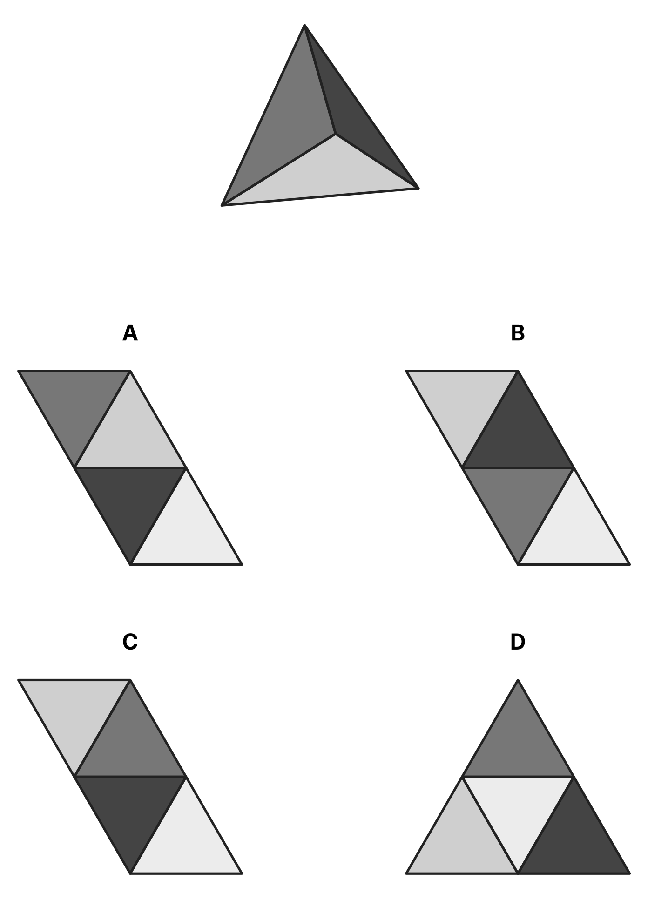
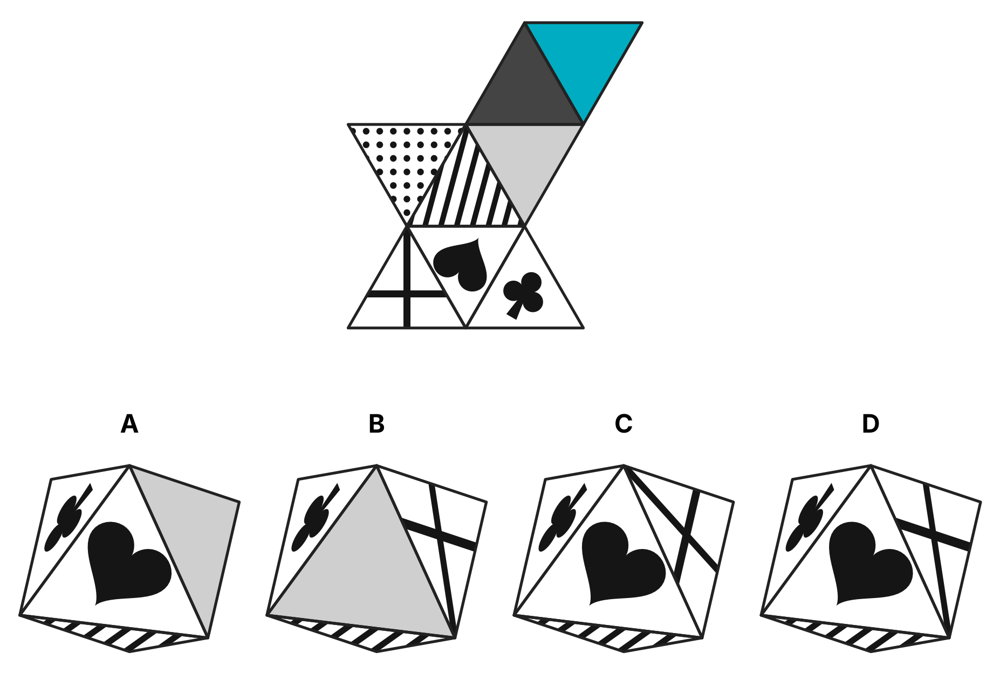
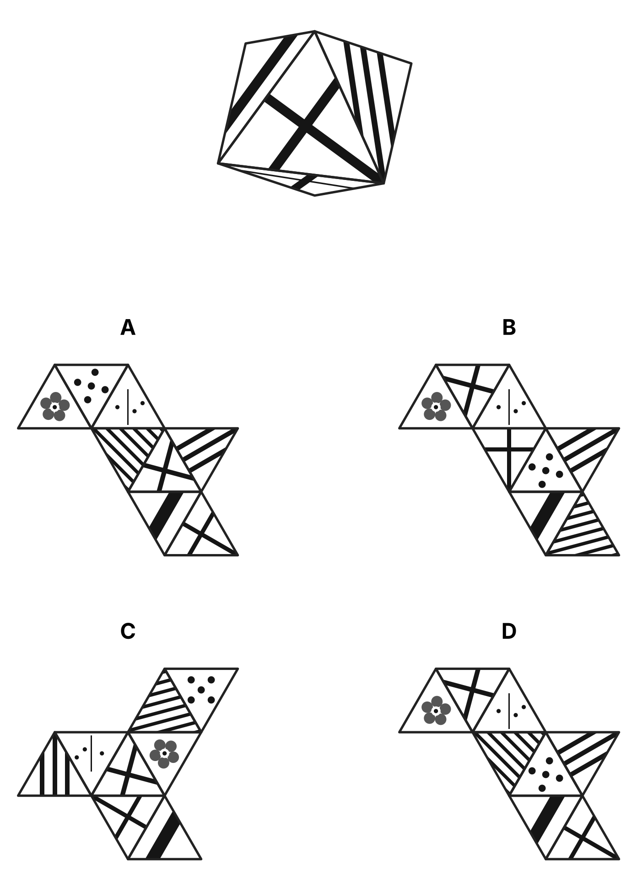
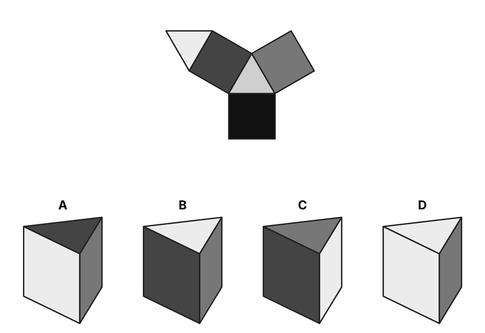

# Figuras desplegables

4 ejercicios · fácil: 0 · media: 0 · difícil: 4

## f0b0d7ff66 · difícil · figura
*Test 012 (2026-11-08), ejercicio 33*

¿Qué desarrollo forma esta figura? (tetraedro)

**Respuesta: C.** Localiza en la figura dos caras vecinas con un símbolo orientado (líneas, dominó…) y busca el desarrollo donde esas caras estén pegadas con ese mismo giro. Las caras opuestas no pueden estar pegadas en el desarrollo.

## 0840915793 · difícil · figura
*Test 012 (2026-11-08), ejercicio 36*

¿Qué figura se forma al plegar este desarrollo? (octaedro)

**Respuesta: D.** Elige dos caras que compartan arista en el desarrollo y comprueba si en la figura esas dos caras están juntas y con el mismo giro; así descartas opciones rápido. Las caras opuestas nunca se ven a la vez.

## f3ae07101f · difícil · figura
*Test 012 (2026-11-08), ejercicio 37*

¿Qué desarrollo forma esta figura? (octaedro)

**Respuesta: D.** Localiza en la figura dos caras vecinas con un símbolo orientado (líneas, dominó…) y busca el desarrollo donde esas caras estén pegadas con ese mismo giro. Las caras opuestas no pueden estar pegadas en el desarrollo.

## a5d49f967e · difícil · figura
*Test 012 (2026-11-08), ejercicio 39*

¿Qué figura se forma al plegar este desarrollo? (prisma triangular)

**Respuesta: B.** Elige dos caras que compartan arista en el desarrollo y comprueba si en la figura esas dos caras están juntas y con el mismo giro; así descartas opciones rápido. Las caras opuestas nunca se ven a la vez.
