# Figuras desplegables

43 ejercicios · fácil: 4 · media: 6 · difícil: 33

## f0b0d7ff66 · difícil · figura
*Test 012 (2026-11-08), ejercicio 33*

¿Qué desarrollo forma esta figura? (tetraedro)

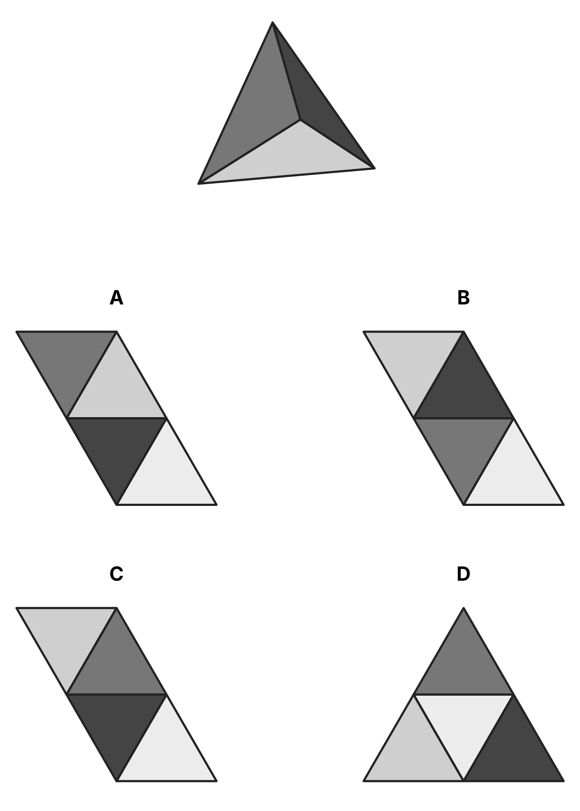

**Respuesta: C.** Localiza en la figura dos caras vecinas con un símbolo orientado (líneas, dominó…) y busca el desarrollo donde esas caras estén pegadas con ese mismo giro. Las caras opuestas no pueden estar pegadas en el desarrollo.

## 0840915793 · difícil · figura
*Test 012 (2026-11-08), ejercicio 36*

¿Qué figura se forma al plegar este desarrollo? (octaedro)

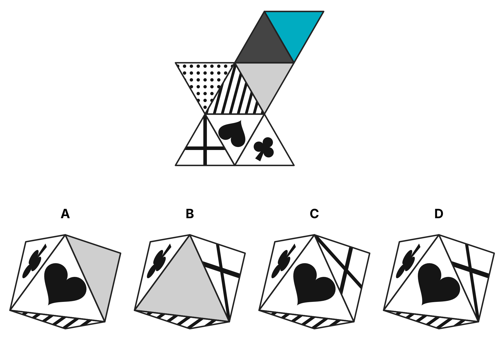

**Respuesta: D.** Elige dos caras que compartan arista en el desarrollo y comprueba si en la figura esas dos caras están juntas y con el mismo giro; así descartas opciones rápido. Las caras opuestas nunca se ven a la vez.

## f3ae07101f · difícil · figura
*Test 012 (2026-11-08), ejercicio 37*

¿Qué desarrollo forma esta figura? (octaedro)

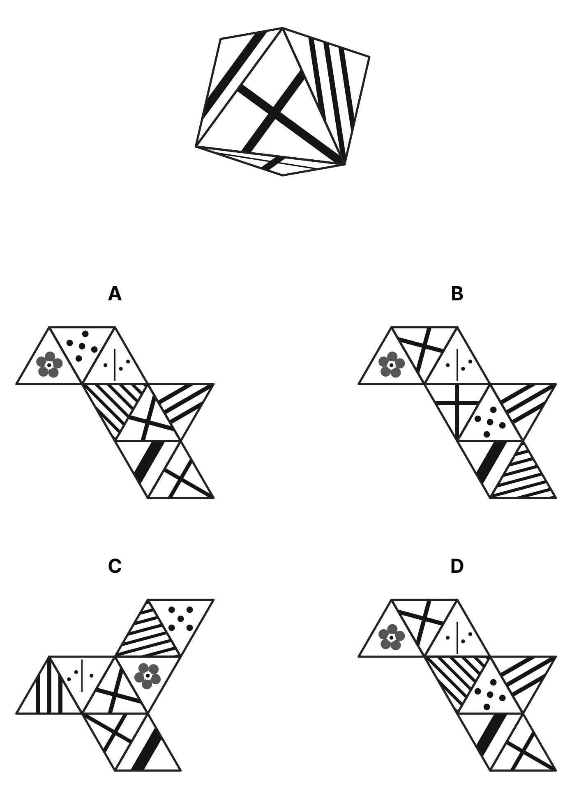

**Respuesta: D.** Localiza en la figura dos caras vecinas con un símbolo orientado (líneas, dominó…) y busca el desarrollo donde esas caras estén pegadas con ese mismo giro. Las caras opuestas no pueden estar pegadas en el desarrollo.

## a5d49f967e · difícil · figura
*Test 012 (2026-11-08), ejercicio 39*

¿Qué figura se forma al plegar este desarrollo? (prisma triangular)

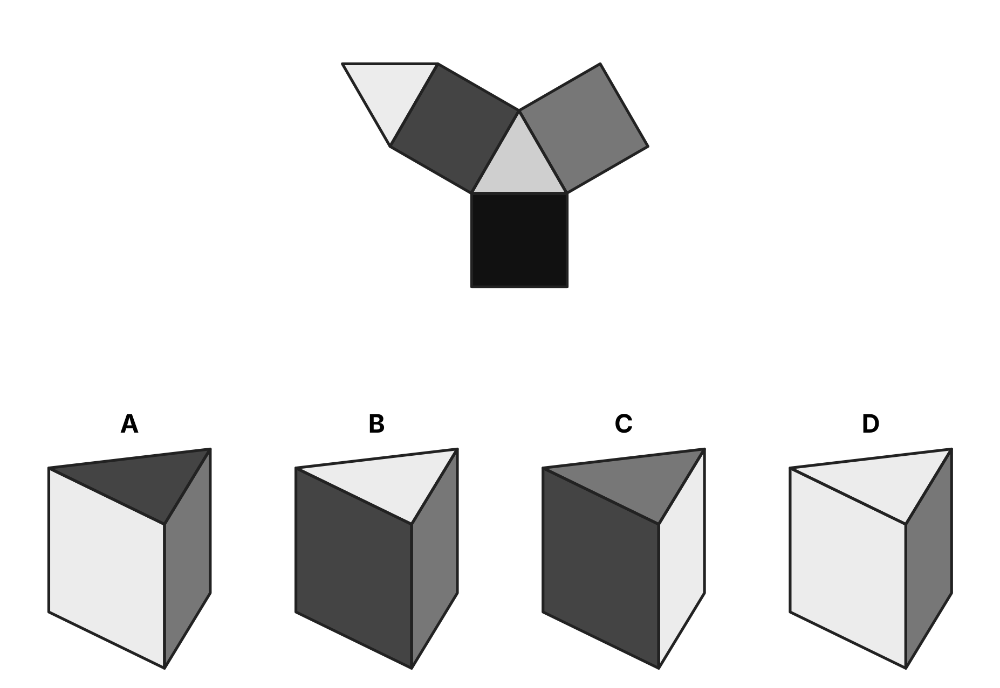

**Respuesta: B.** Elige dos caras que compartan arista en el desarrollo y comprueba si en la figura esas dos caras están juntas y con el mismo giro; así descartas opciones rápido. Las caras opuestas nunca se ven a la vez.

## abf5ec646d · difícil · figura
*Test 014 (2026-11-10), ejercicio 25*

¿Qué figura se forma al plegar este desarrollo? (prisma triangular)

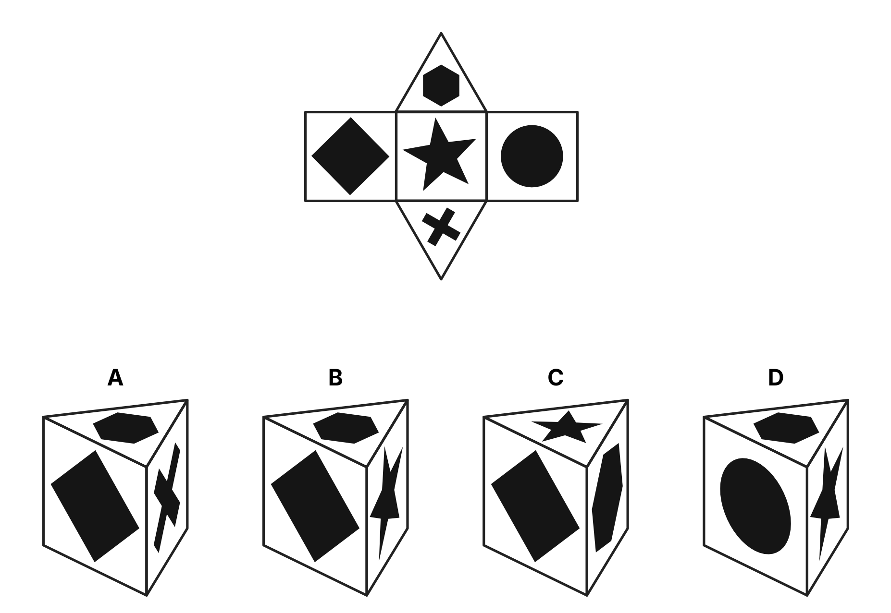

**Respuesta: B.** Elige dos caras que compartan arista en el desarrollo y comprueba si en la figura esas dos caras están juntas y con el mismo giro; así descartas opciones rápido. Las caras opuestas nunca se ven a la vez.

## a7a9167cb8 · difícil · figura
*Test 014 (2026-11-10), ejercicio 27*

¿Qué figura se forma al plegar este desarrollo? (tetraedro)

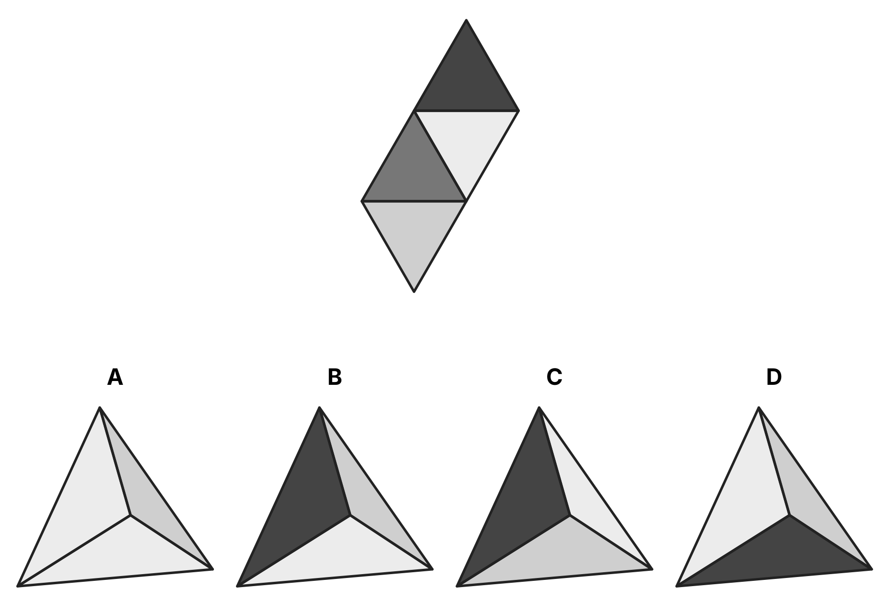

**Respuesta: B.** Elige dos caras que compartan arista en el desarrollo y comprueba si en la figura esas dos caras están juntas y con el mismo giro; así descartas opciones rápido. Las caras opuestas nunca se ven a la vez.

## 09a37e1016 · fácil · figura
*Test 014 (2026-11-10), ejercicio 29*

¿Qué desarrollo forma esta figura? (cubo)

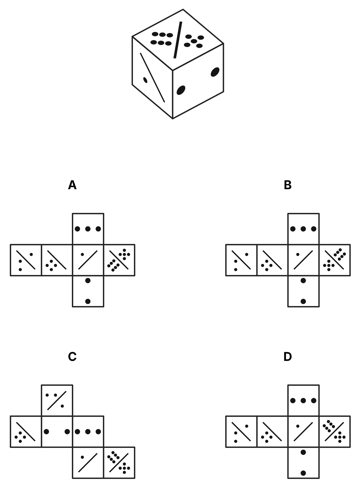

**Respuesta: D.** Localiza en la figura dos caras vecinas con un símbolo orientado (líneas, dominó…) y busca el desarrollo donde esas caras estén pegadas con ese mismo giro. Las caras opuestas no pueden estar pegadas en el desarrollo.

## 6dd7625321 · fácil · figura
*Test 014 (2026-11-10), ejercicio 31*

¿Qué figura se forma al plegar este desarrollo? (cubo)

**Respuesta: C.** Elige dos caras que compartan arista en el desarrollo y comprueba si en la figura esas dos caras están juntas y con el mismo giro; así descartas opciones rápido. Las caras opuestas nunca se ven a la vez.

## 528c62fdd1 · difícil · figura
*Test 015 (2026-11-11), ejercicio 25*

¿Qué desarrollo forma esta figura? (prisma triangular)

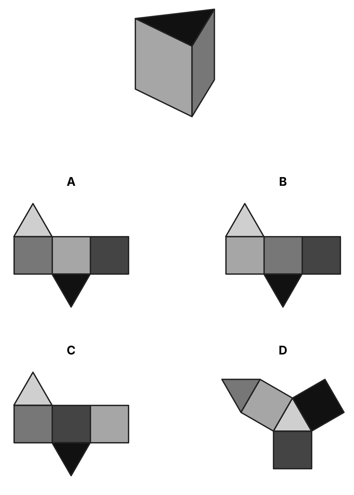

**Respuesta: A.** Localiza en la figura dos caras vecinas con un símbolo orientado (líneas, dominó…) y busca el desarrollo donde esas caras estén pegadas con ese mismo giro. Las caras opuestas no pueden estar pegadas en el desarrollo.

## 8cc93f5776 · difícil · figura
*Test 015 (2026-11-11), ejercicio 27*

¿Qué figura se forma al plegar este desarrollo? (octaedro)

**Respuesta: D.** Elige dos caras que compartan arista en el desarrollo y comprueba si en la figura esas dos caras están juntas y con el mismo giro; así descartas opciones rápido. Las caras opuestas nunca se ven a la vez.

## 008c22d53c · difícil · figura
*Test 015 (2026-11-11), ejercicio 28*

¿Qué figura se forma al plegar este desarrollo? (prisma triangular)

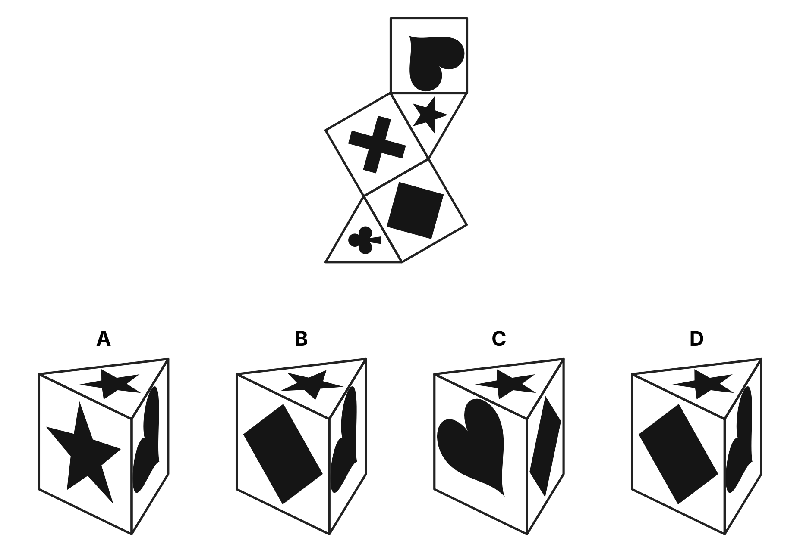

**Respuesta: D.** Elige dos caras que compartan arista en el desarrollo y comprueba si en la figura esas dos caras están juntas y con el mismo giro; así descartas opciones rápido. Las caras opuestas nunca se ven a la vez.

## 37c440f8a7 · difícil · figura
*Test 015 (2026-11-11), ejercicio 29*

¿Qué figura se forma al plegar este desarrollo? (pirámide cuadrada)

**Respuesta: C.** Elige dos caras que compartan arista en el desarrollo y comprueba si en la figura esas dos caras están juntas y con el mismo giro; así descartas opciones rápido. Las caras opuestas nunca se ven a la vez.

## 7710d34377 · media · figura
*Test 017 (2026-11-13), ejercicio 25*

¿Qué figura se forma al plegar este desarrollo? (cubo)

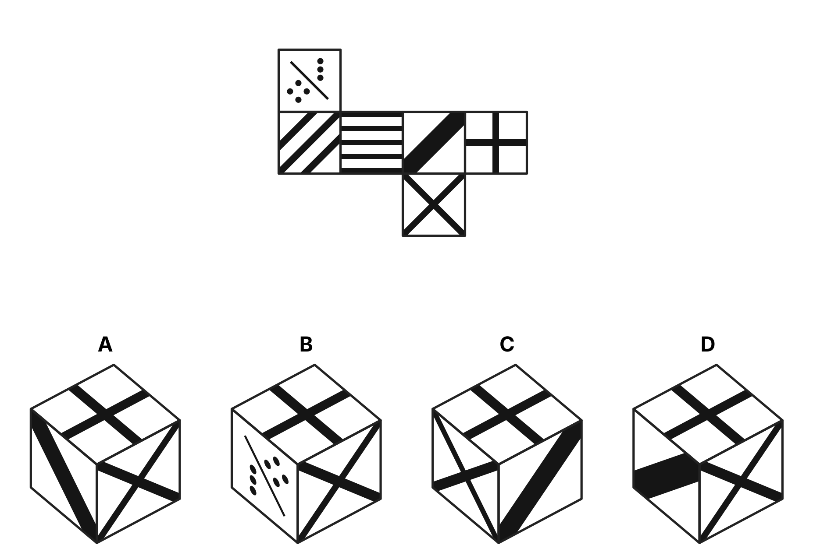

**Respuesta: A.** Elige dos caras que compartan arista en el desarrollo y comprueba si en la figura esas dos caras están juntas y con el mismo giro; así descartas opciones rápido. Las caras opuestas nunca se ven a la vez.

## 47efca0207 · media · figura
*Test 017 (2026-11-13), ejercicio 28*

¿Qué desarrollo forma esta figura? (cubo)

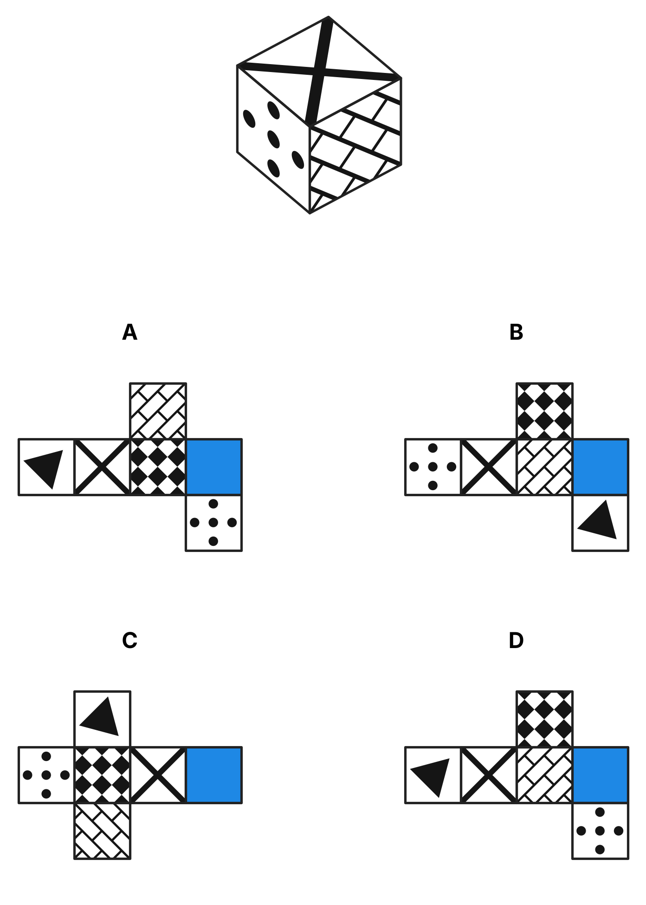

**Respuesta: D.** Localiza en la figura dos caras vecinas con un símbolo orientado (líneas, dominó…) y busca el desarrollo donde esas caras estén pegadas con ese mismo giro. Las caras opuestas no pueden estar pegadas en el desarrollo.

## 0f226d31c1 · difícil · figura
*Test 017 (2026-11-13), ejercicio 30*

¿Qué desarrollo forma esta figura? (tetraedro)

**Respuesta: D.** Localiza en la figura dos caras vecinas con un símbolo orientado (líneas, dominó…) y busca el desarrollo donde esas caras estén pegadas con ese mismo giro. Las caras opuestas no pueden estar pegadas en el desarrollo.

## 53bab7b43c · difícil · figura
*Test 017 (2026-11-13), ejercicio 32*

¿Qué desarrollo forma esta figura? (pirámide cuadrada)

**Respuesta: D.** Localiza en la figura dos caras vecinas con un símbolo orientado (líneas, dominó…) y busca el desarrollo donde esas caras estén pegadas con ese mismo giro. Las caras opuestas no pueden estar pegadas en el desarrollo.

## 687518b505 · difícil · figura
*Test 020 (2026-11-16), ejercicio 28*

¿Qué desarrollo forma esta figura? (tetraedro)

**Respuesta: B.** Localiza en la figura dos caras vecinas con un símbolo orientado (líneas, dominó…) y busca el desarrollo donde esas caras estén pegadas con ese mismo giro. Las caras opuestas no pueden estar pegadas en el desarrollo.

## cdac7b4a18 · difícil · figura
*Test 020 (2026-11-16), ejercicio 29*

¿Qué figura se forma al plegar este desarrollo? (octaedro)

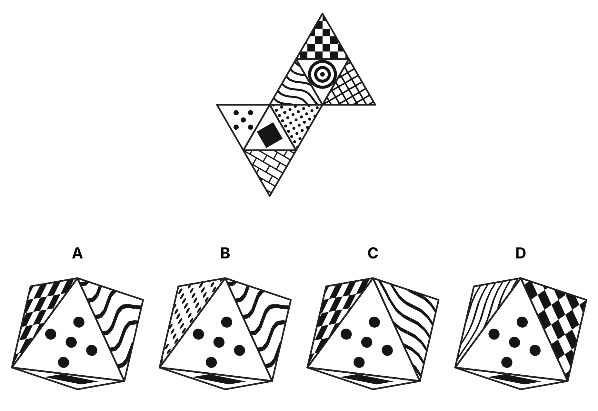

**Respuesta: A.** Elige dos caras que compartan arista en el desarrollo y comprueba si en la figura esas dos caras están juntas y con el mismo giro; así descartas opciones rápido. Las caras opuestas nunca se ven a la vez.

## a8a5a7167e · difícil · figura
*Test 020 (2026-11-16), ejercicio 33*

¿Qué desarrollo forma esta figura? (prisma triangular)

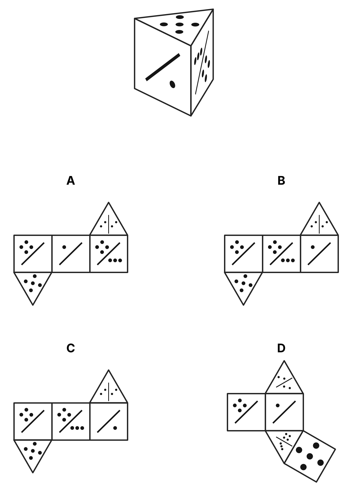

**Respuesta: B.** Localiza en la figura dos caras vecinas con un símbolo orientado (líneas, dominó…) y busca el desarrollo donde esas caras estén pegadas con ese mismo giro. Las caras opuestas no pueden estar pegadas en el desarrollo.

## 94f59d373b · difícil · figura
*Test 020 (2026-11-16), ejercicio 34*

¿Qué desarrollo forma esta figura? (pirámide cuadrada)

**Respuesta: A.** Localiza en la figura dos caras vecinas con un símbolo orientado (líneas, dominó…) y busca el desarrollo donde esas caras estén pegadas con ese mismo giro. Las caras opuestas no pueden estar pegadas en el desarrollo.

## a4eb2c4cf9 · difícil · figura
*Test 021 (2026-11-17), ejercicio 27*

¿Qué desarrollo forma esta figura? (tetraedro)

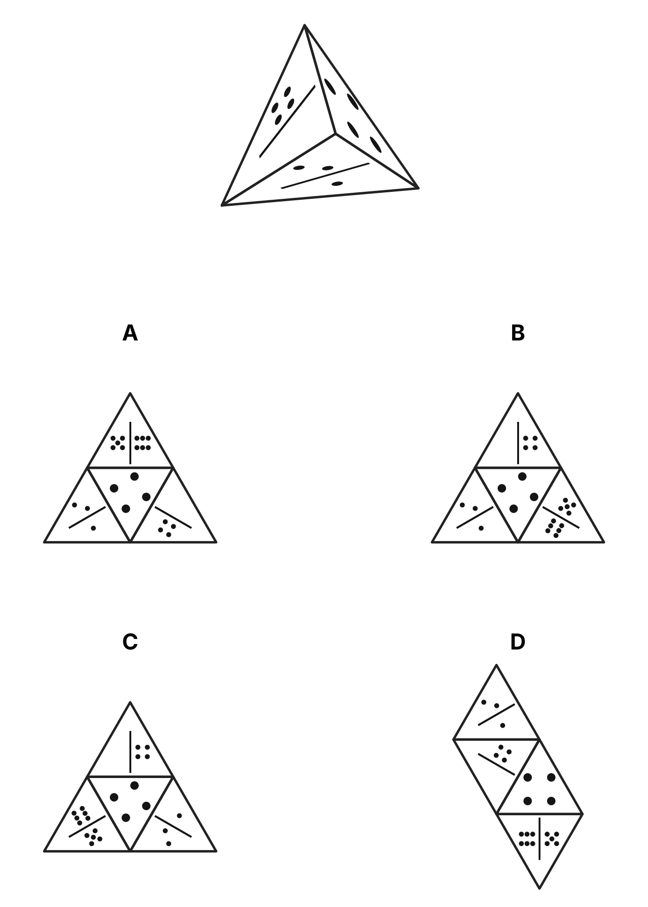

**Respuesta: B.** Localiza en la figura dos caras vecinas con un símbolo orientado (líneas, dominó…) y busca el desarrollo donde esas caras estén pegadas con ese mismo giro. Las caras opuestas no pueden estar pegadas en el desarrollo.

## c80b0fcf42 · difícil · figura
*Test 021 (2026-11-17), ejercicio 28*

¿Qué figura se forma al plegar este desarrollo? (tetraedro)

**Respuesta: B.** Elige dos caras que compartan arista en el desarrollo y comprueba si en la figura esas dos caras están juntas y con el mismo giro; así descartas opciones rápido. Las caras opuestas nunca se ven a la vez.

## 050c2199b2 · difícil · figura
*Test 021 (2026-11-17), ejercicio 32*

¿Qué figura se forma al plegar este desarrollo? (pirámide cuadrada)

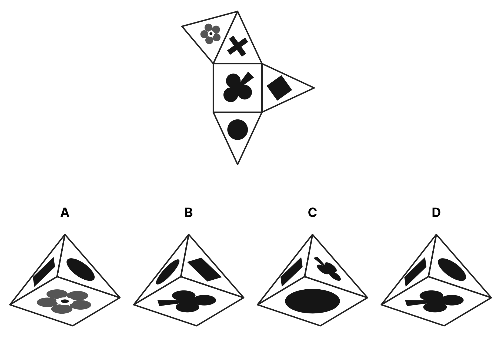

**Respuesta: D.** Elige dos caras que compartan arista en el desarrollo y comprueba si en la figura esas dos caras están juntas y con el mismo giro; así descartas opciones rápido. Las caras opuestas nunca se ven a la vez.

## f7fba5e750 · difícil · figura
*Test 021 (2026-11-17), ejercicio 34*

¿Qué figura se forma al plegar este desarrollo? (octaedro)

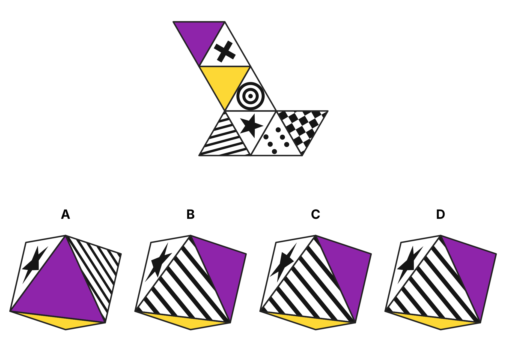

**Respuesta: D.** Elige dos caras que compartan arista en el desarrollo y comprueba si en la figura esas dos caras están juntas y con el mismo giro; así descartas opciones rápido. Las caras opuestas nunca se ven a la vez.

## ae1bf86360 · fácil · figura
*Test 023 (2026-11-19), ejercicio 29*

¿Qué desarrollo forma esta figura? (cubo)

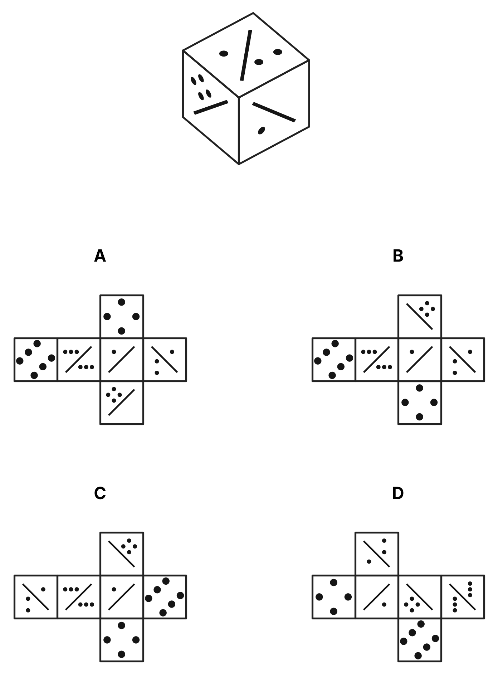

**Respuesta: B.** Localiza en la figura dos caras vecinas con un símbolo orientado (líneas, dominó…) y busca el desarrollo donde esas caras estén pegadas con ese mismo giro. Las caras opuestas no pueden estar pegadas en el desarrollo.

## 791b14f4b3 · media · figura
*Test 023 (2026-11-19), ejercicio 30*

¿Qué figura se forma al plegar este desarrollo? (cubo)

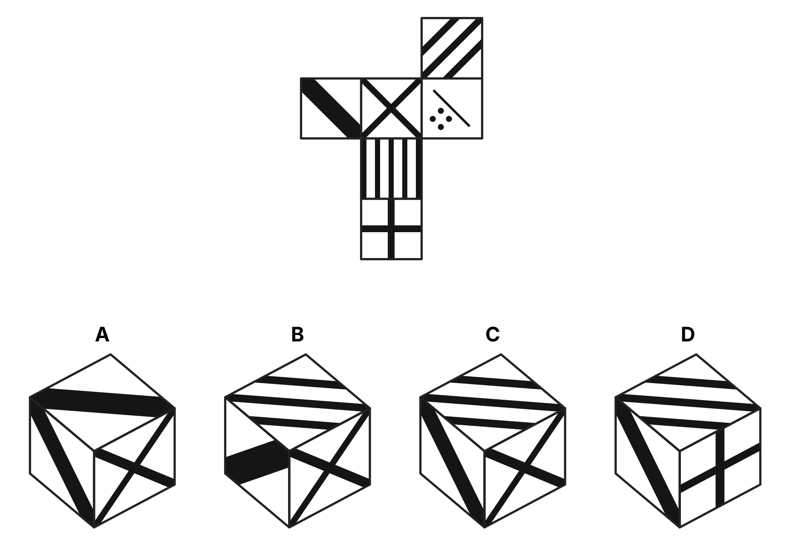

**Respuesta: C.** Elige dos caras que compartan arista en el desarrollo y comprueba si en la figura esas dos caras están juntas y con el mismo giro; así descartas opciones rápido. Las caras opuestas nunca se ven a la vez.

## 8ae368ee92 · difícil · figura
*Test 023 (2026-11-19), ejercicio 32*

¿Qué desarrollo forma esta figura? (pirámide cuadrada)

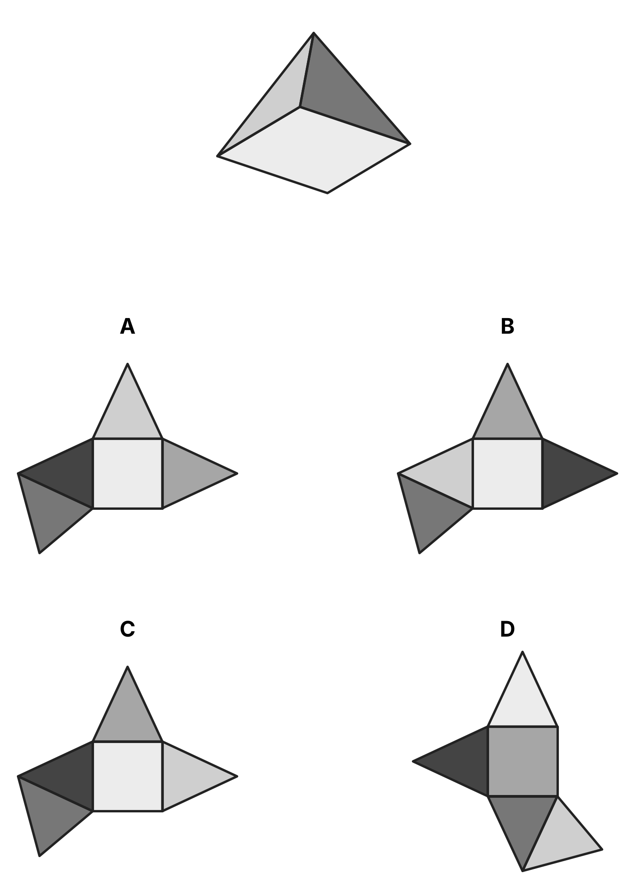

**Respuesta: C.** Localiza en la figura dos caras vecinas con un símbolo orientado (líneas, dominó…) y busca el desarrollo donde esas caras estén pegadas con ese mismo giro. Las caras opuestas no pueden estar pegadas en el desarrollo.

## 27920ab832 · difícil · figura
*Test 023 (2026-11-19), ejercicio 33*

¿Qué desarrollo forma esta figura? (octaedro)

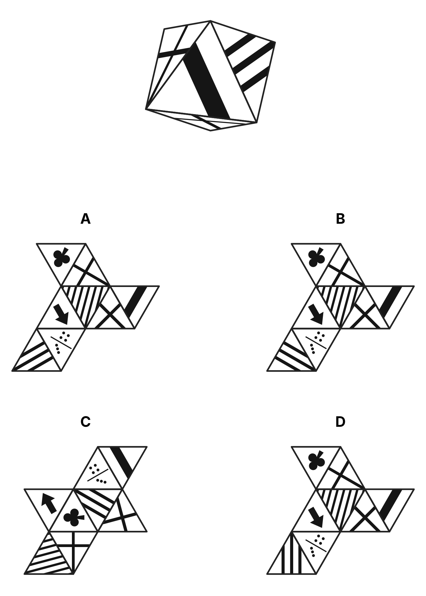

**Respuesta: D.** Localiza en la figura dos caras vecinas con un símbolo orientado (líneas, dominó…) y busca el desarrollo donde esas caras estén pegadas con ese mismo giro. Las caras opuestas no pueden estar pegadas en el desarrollo.

## c4bf274aea · fácil · figura
*Test 024 (2026-11-20), ejercicio 32*

¿Qué desarrollo forma esta figura? (cubo)

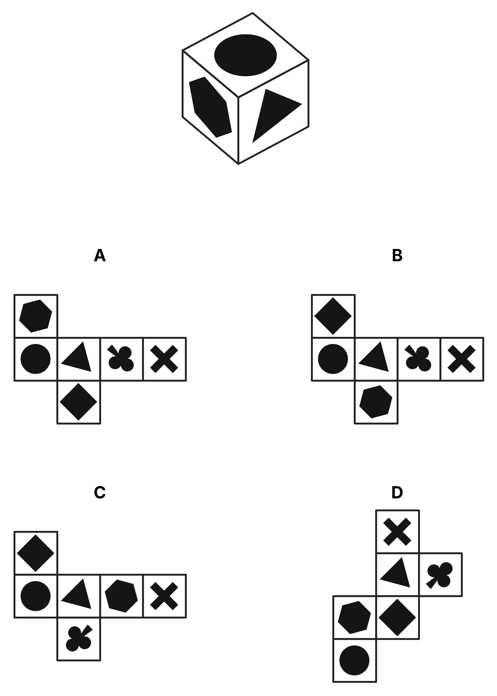

**Respuesta: B.** Localiza en la figura dos caras vecinas con un símbolo orientado (líneas, dominó…) y busca el desarrollo donde esas caras estén pegadas con ese mismo giro. Las caras opuestas no pueden estar pegadas en el desarrollo.

## 36bee6a929 · difícil · figura
*Test 024 (2026-11-20), ejercicio 33*

¿Qué figura se forma al plegar este desarrollo? (octaedro)

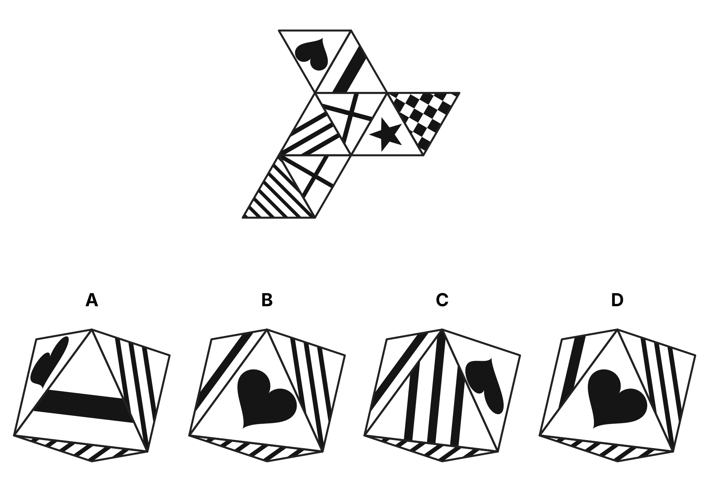

**Respuesta: B.** Elige dos caras que compartan arista en el desarrollo y comprueba si en la figura esas dos caras están juntas y con el mismo giro; así descartas opciones rápido. Las caras opuestas nunca se ven a la vez.

## 24eba2c2bc · difícil · figura
*Test 024 (2026-11-20), ejercicio 38*

¿Qué figura se forma al plegar este desarrollo? (prisma triangular)

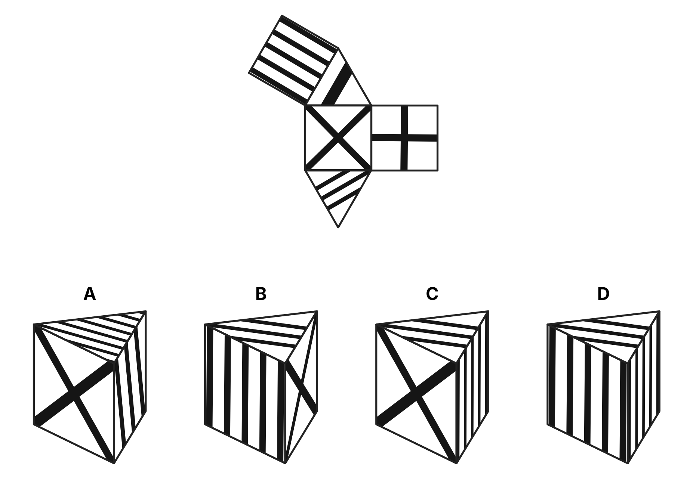

**Respuesta: C.** Elige dos caras que compartan arista en el desarrollo y comprueba si en la figura esas dos caras están juntas y con el mismo giro; así descartas opciones rápido. Las caras opuestas nunca se ven a la vez.

## a617456eee · media · figura
*Test 024 (2026-11-20), ejercicio 39*

¿Qué desarrollo forma esta figura? (cubo)

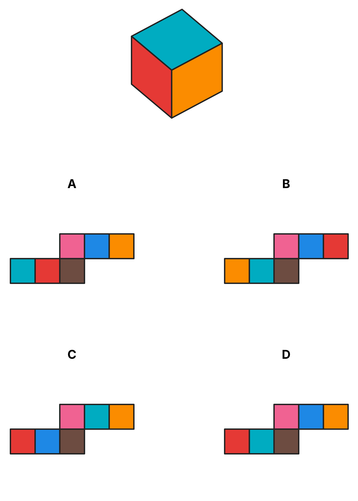

**Respuesta: D.** Localiza en la figura dos caras vecinas con un símbolo orientado (líneas, dominó…) y busca el desarrollo donde esas caras estén pegadas con ese mismo giro. Las caras opuestas no pueden estar pegadas en el desarrollo.

## 187f9f0c61 · difícil · figura
*Test 026 (2026-11-22), ejercicio 29*

¿Qué desarrollo forma esta figura? (pirámide cuadrada)

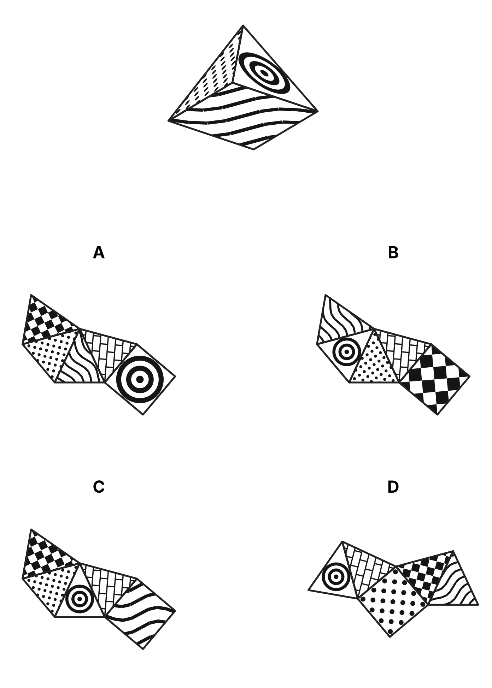

**Respuesta: C.** Localiza en la figura dos caras vecinas con un símbolo orientado (líneas, dominó…) y busca el desarrollo donde esas caras estén pegadas con ese mismo giro. Las caras opuestas no pueden estar pegadas en el desarrollo.

## a0cc3b5322 · difícil · figura
*Test 026 (2026-11-22), ejercicio 30*

¿Qué desarrollo forma esta figura? (tetraedro)

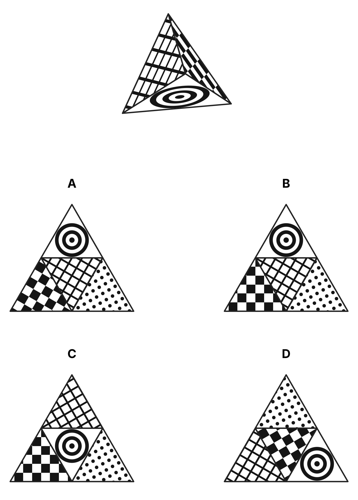

**Respuesta: B.** Localiza en la figura dos caras vecinas con un símbolo orientado (líneas, dominó…) y busca el desarrollo donde esas caras estén pegadas con ese mismo giro. Las caras opuestas no pueden estar pegadas en el desarrollo.

## ad94047c5f · difícil · figura
*Test 026 (2026-11-22), ejercicio 32*

¿Qué figura se forma al plegar este desarrollo? (prisma triangular)

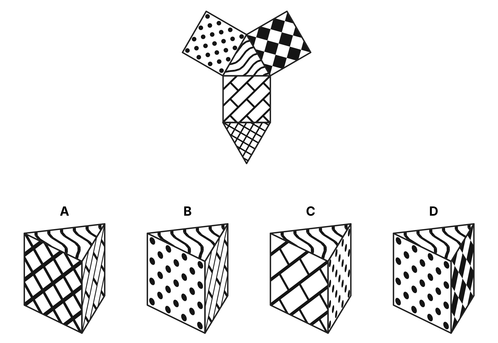

**Respuesta: B.** Elige dos caras que compartan arista en el desarrollo y comprueba si en la figura esas dos caras están juntas y con el mismo giro; así descartas opciones rápido. Las caras opuestas nunca se ven a la vez.

## ebc6ec65cb · media · figura
*Test 026 (2026-11-22), ejercicio 37*

¿Qué figura se forma al plegar este desarrollo? (cubo)

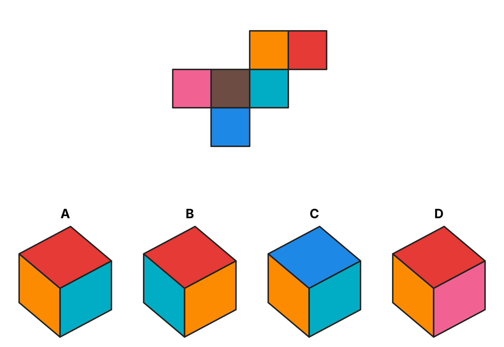

**Respuesta: A.** Elige dos caras que compartan arista en el desarrollo y comprueba si en la figura esas dos caras están juntas y con el mismo giro; así descartas opciones rápido. Las caras opuestas nunca se ven a la vez.

## 49f22b3cc8 · difícil · figura
*Test 027 (2026-11-23), ejercicio 25*

¿Qué desarrollo forma esta figura? (octaedro)

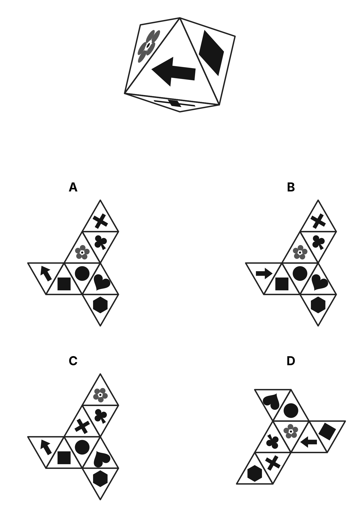

**Respuesta: A.** Localiza en la figura dos caras vecinas con un símbolo orientado (líneas, dominó…) y busca el desarrollo donde esas caras estén pegadas con ese mismo giro. Las caras opuestas no pueden estar pegadas en el desarrollo.

## 3a71ca91b3 · difícil · figura
*Test 027 (2026-11-23), ejercicio 26*

¿Qué desarrollo forma esta figura? (tetraedro)

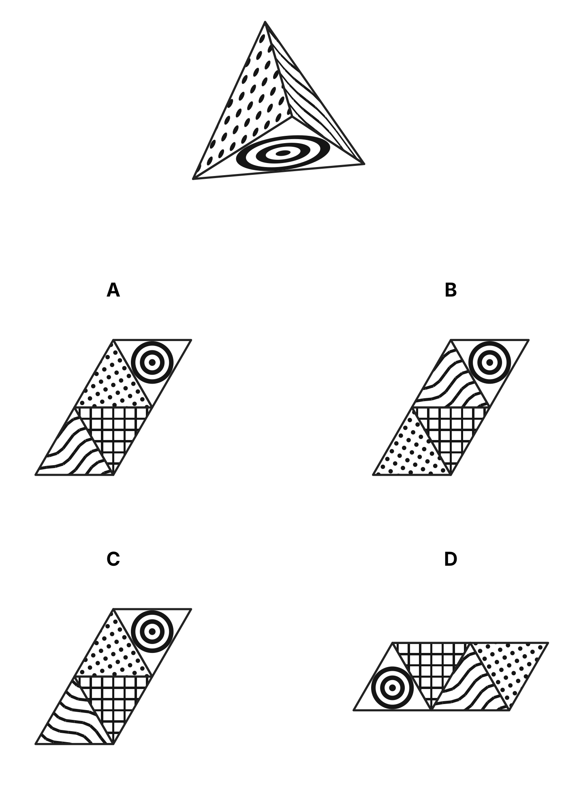

**Respuesta: C.** Localiza en la figura dos caras vecinas con un símbolo orientado (líneas, dominó…) y busca el desarrollo donde esas caras estén pegadas con ese mismo giro. Las caras opuestas no pueden estar pegadas en el desarrollo.

## e99f8083db · media · figura
*Test 027 (2026-11-23), ejercicio 30*

¿Qué figura se forma al plegar este desarrollo? (cubo)

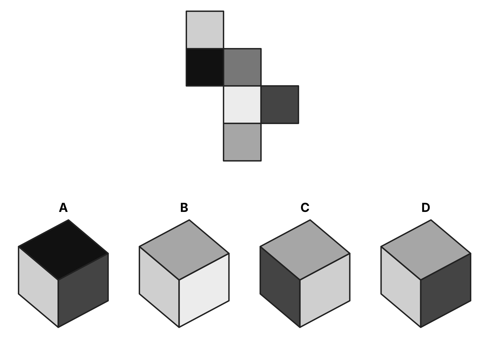

**Respuesta: D.** Elige dos caras que compartan arista en el desarrollo y comprueba si en la figura esas dos caras están juntas y con el mismo giro; así descartas opciones rápido. Las caras opuestas nunca se ven a la vez.

## e80e99fd18 · difícil · figura
*Test 029 (2026-11-25), ejercicio 31*

¿Qué desarrollo forma esta figura? (pirámide cuadrada)

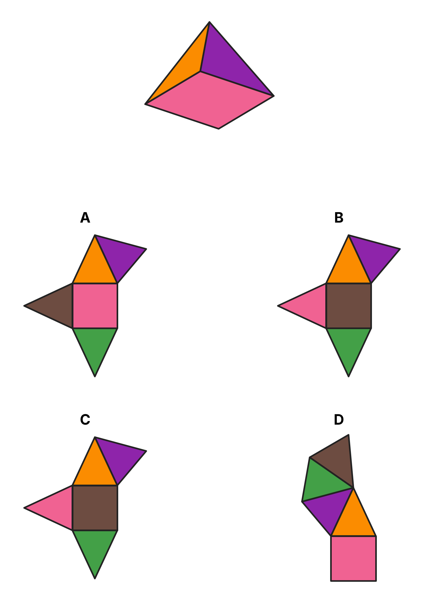

**Respuesta: A.** Localiza en la figura dos caras vecinas con un símbolo orientado (líneas, dominó…) y busca el desarrollo donde esas caras estén pegadas con ese mismo giro. Las caras opuestas no pueden estar pegadas en el desarrollo.

## 96e194453d · difícil · figura
*Test 029 (2026-11-25), ejercicio 32*

¿Qué desarrollo forma esta figura? (prisma triangular)

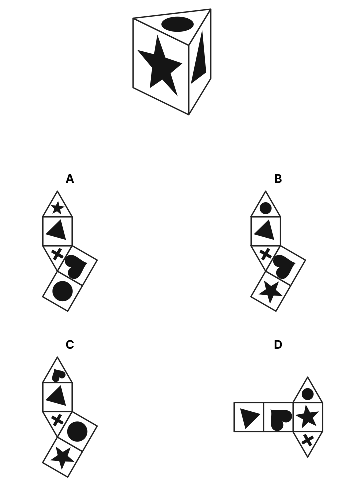

**Respuesta: B.** Localiza en la figura dos caras vecinas con un símbolo orientado (líneas, dominó…) y busca el desarrollo donde esas caras estén pegadas con ese mismo giro. Las caras opuestas no pueden estar pegadas en el desarrollo.

## df5d991057 · difícil · figura
*Test 029 (2026-11-25), ejercicio 33*

¿Qué desarrollo forma esta figura? (tetraedro)

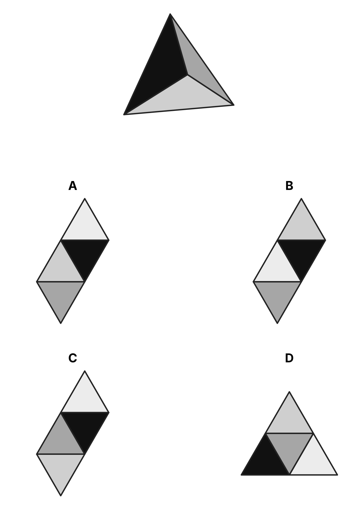

**Respuesta: A.** Localiza en la figura dos caras vecinas con un símbolo orientado (líneas, dominó…) y busca el desarrollo donde esas caras estén pegadas con ese mismo giro. Las caras opuestas no pueden estar pegadas en el desarrollo.

## 5bda2e6d2e · difícil · figura
*Test 029 (2026-11-25), ejercicio 34*

¿Qué desarrollo forma esta figura? (tetraedro)

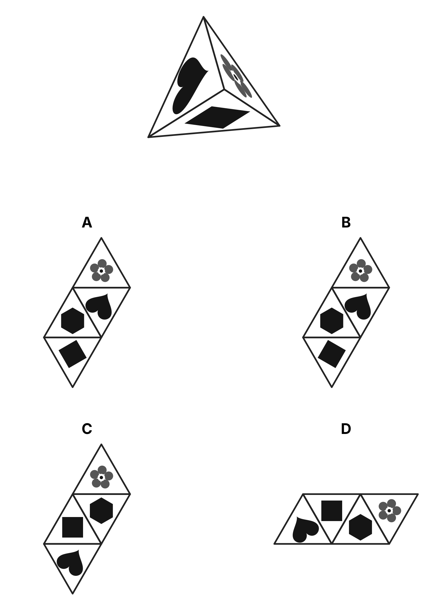

**Respuesta: B.** Localiza en la figura dos caras vecinas con un símbolo orientado (líneas, dominó…) y busca el desarrollo donde esas caras estén pegadas con ese mismo giro. Las caras opuestas no pueden estar pegadas en el desarrollo.
