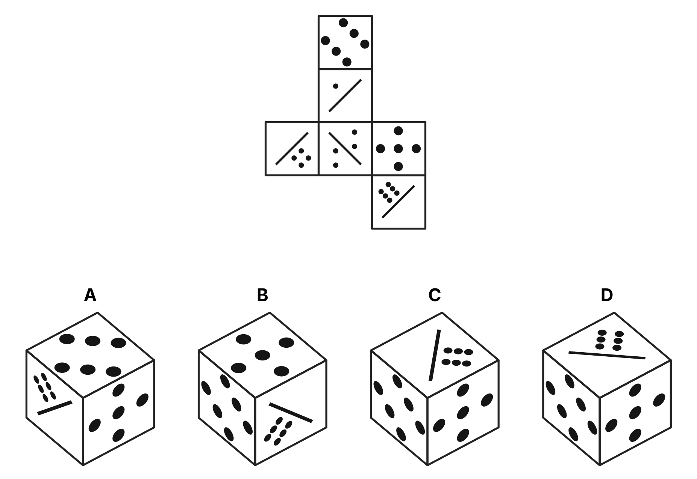
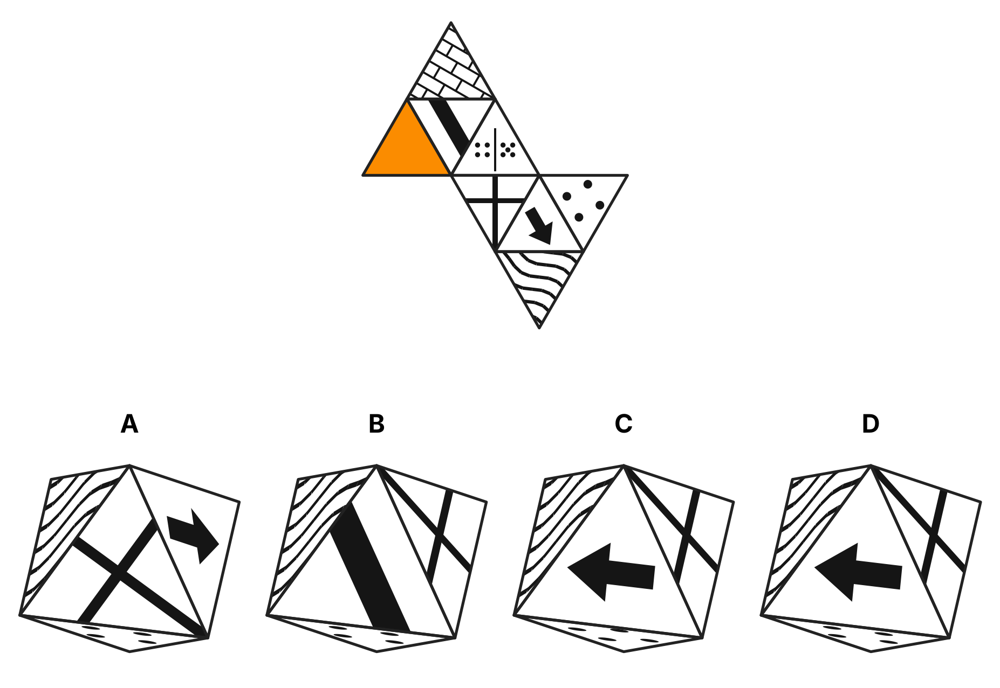
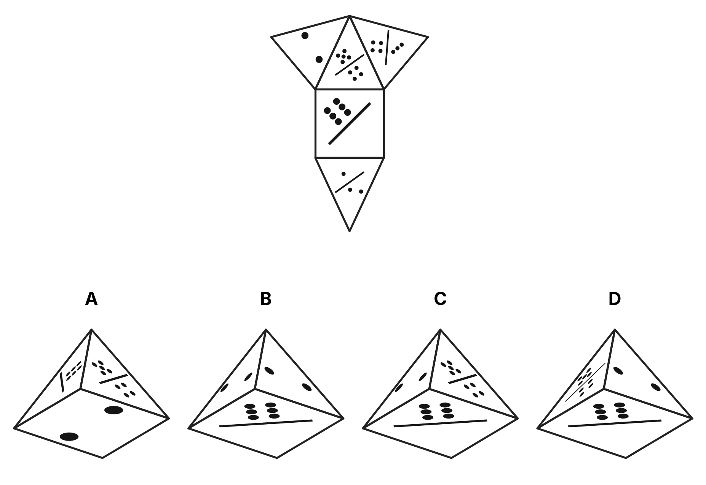
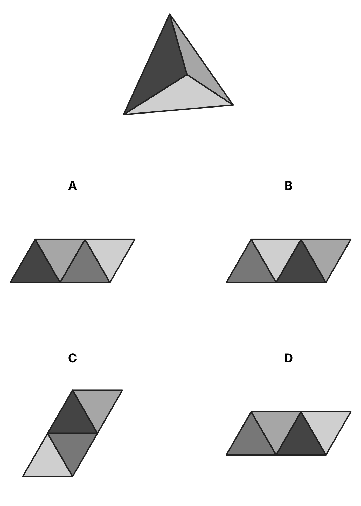
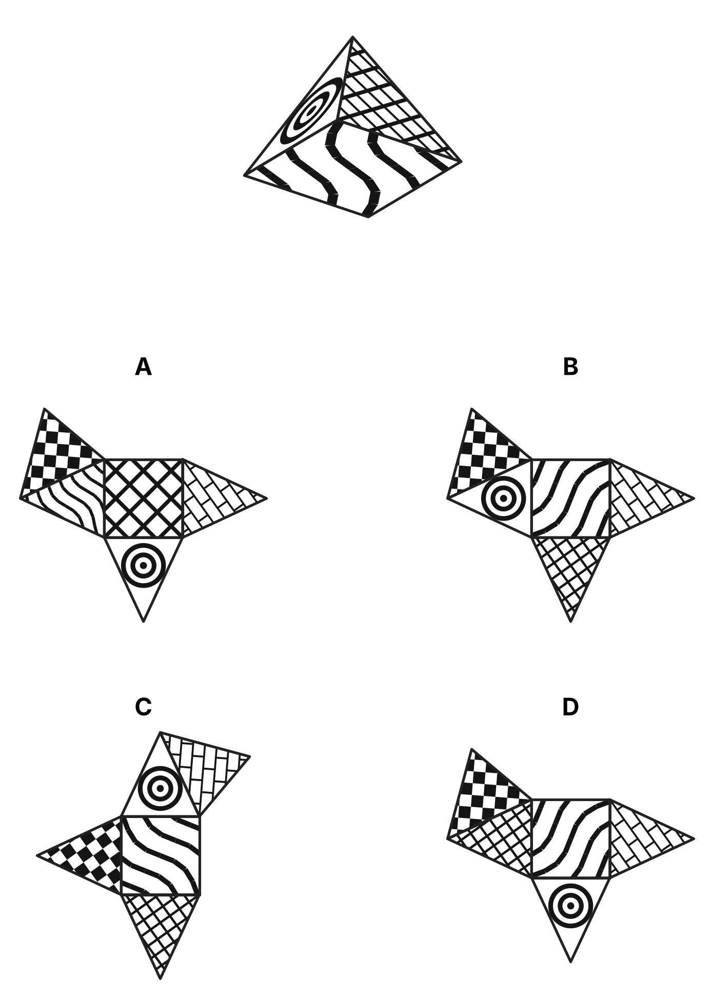
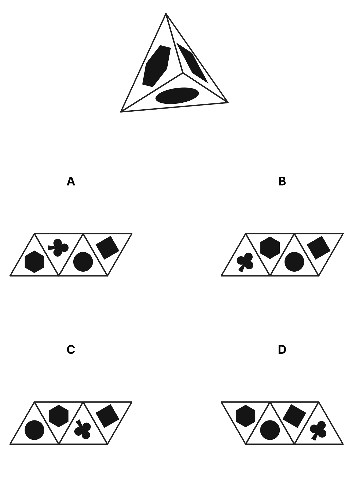
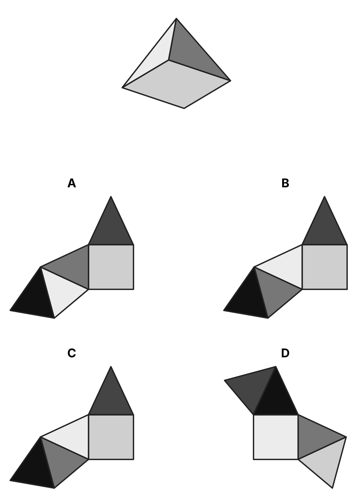
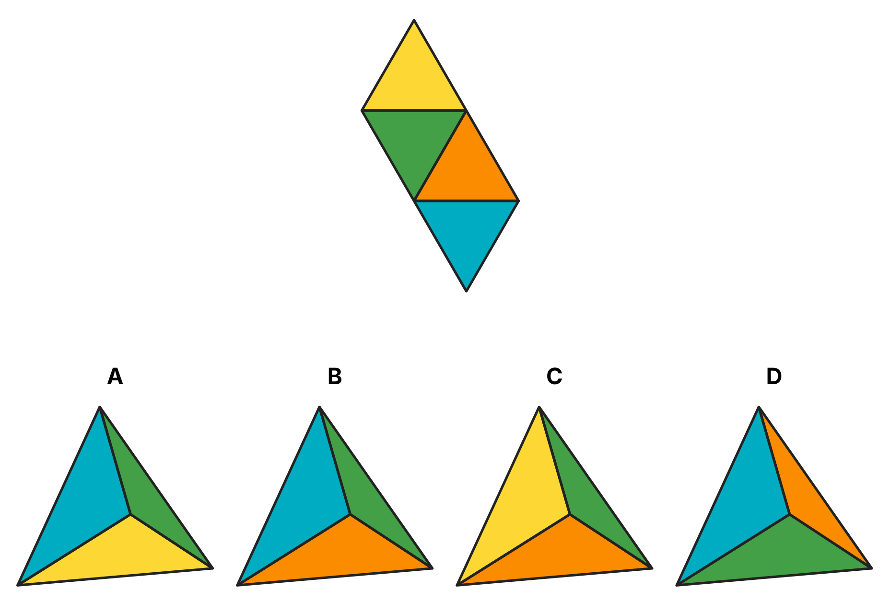

# Figuras desplegables

24 ejercicios · fácil: 2 · media: 2 · difícil: 20

## f0b0d7ff66 · difícil · figura
*Test 012 (2026-11-08), ejercicio 33*

¿Qué desarrollo forma esta figura? (tetraedro)

**Respuesta: C.** Localiza en la figura dos caras vecinas con un símbolo orientado (líneas, dominó…) y busca el desarrollo donde esas caras estén pegadas con ese mismo giro. Las caras opuestas no pueden estar pegadas en el desarrollo.

## 0840915793 · difícil · figura
*Test 012 (2026-11-08), ejercicio 36*

¿Qué figura se forma al plegar este desarrollo? (octaedro)

**Respuesta: D.** Elige dos caras que compartan arista en el desarrollo y comprueba si en la figura esas dos caras están juntas y con el mismo giro; así descartas opciones rápido. Las caras opuestas nunca se ven a la vez.

## f3ae07101f · difícil · figura
*Test 012 (2026-11-08), ejercicio 37*

¿Qué desarrollo forma esta figura? (octaedro)

**Respuesta: D.** Localiza en la figura dos caras vecinas con un símbolo orientado (líneas, dominó…) y busca el desarrollo donde esas caras estén pegadas con ese mismo giro. Las caras opuestas no pueden estar pegadas en el desarrollo.

## a5d49f967e · difícil · figura
*Test 012 (2026-11-08), ejercicio 39*

¿Qué figura se forma al plegar este desarrollo? (prisma triangular)

**Respuesta: B.** Elige dos caras que compartan arista en el desarrollo y comprueba si en la figura esas dos caras están juntas y con el mismo giro; así descartas opciones rápido. Las caras opuestas nunca se ven a la vez.

## abf5ec646d · difícil · figura
*Test 014 (2026-11-10), ejercicio 25*

¿Qué figura se forma al plegar este desarrollo? (prisma triangular)

**Respuesta: B.** Elige dos caras que compartan arista en el desarrollo y comprueba si en la figura esas dos caras están juntas y con el mismo giro; así descartas opciones rápido. Las caras opuestas nunca se ven a la vez.

## a7a9167cb8 · difícil · figura
*Test 014 (2026-11-10), ejercicio 27*

¿Qué figura se forma al plegar este desarrollo? (tetraedro)

**Respuesta: B.** Elige dos caras que compartan arista en el desarrollo y comprueba si en la figura esas dos caras están juntas y con el mismo giro; así descartas opciones rápido. Las caras opuestas nunca se ven a la vez.

## 09a37e1016 · fácil · figura
*Test 014 (2026-11-10), ejercicio 29*

¿Qué desarrollo forma esta figura? (cubo)

**Respuesta: D.** Localiza en la figura dos caras vecinas con un símbolo orientado (líneas, dominó…) y busca el desarrollo donde esas caras estén pegadas con ese mismo giro. Las caras opuestas no pueden estar pegadas en el desarrollo.

## 6dd7625321 · fácil · figura
*Test 014 (2026-11-10), ejercicio 31*

¿Qué figura se forma al plegar este desarrollo? (cubo)

**Respuesta: C.** Elige dos caras que compartan arista en el desarrollo y comprueba si en la figura esas dos caras están juntas y con el mismo giro; así descartas opciones rápido. Las caras opuestas nunca se ven a la vez.

## 528c62fdd1 · difícil · figura
*Test 015 (2026-11-11), ejercicio 25*

¿Qué desarrollo forma esta figura? (prisma triangular)

**Respuesta: A.** Localiza en la figura dos caras vecinas con un símbolo orientado (líneas, dominó…) y busca el desarrollo donde esas caras estén pegadas con ese mismo giro. Las caras opuestas no pueden estar pegadas en el desarrollo.

## 8cc93f5776 · difícil · figura
*Test 015 (2026-11-11), ejercicio 27*

¿Qué figura se forma al plegar este desarrollo? (octaedro)

**Respuesta: D.** Elige dos caras que compartan arista en el desarrollo y comprueba si en la figura esas dos caras están juntas y con el mismo giro; así descartas opciones rápido. Las caras opuestas nunca se ven a la vez.

## 008c22d53c · difícil · figura
*Test 015 (2026-11-11), ejercicio 28*

¿Qué figura se forma al plegar este desarrollo? (prisma triangular)

**Respuesta: D.** Elige dos caras que compartan arista en el desarrollo y comprueba si en la figura esas dos caras están juntas y con el mismo giro; así descartas opciones rápido. Las caras opuestas nunca se ven a la vez.

## 37c440f8a7 · difícil · figura
*Test 015 (2026-11-11), ejercicio 29*

¿Qué figura se forma al plegar este desarrollo? (pirámide cuadrada)

**Respuesta: C.** Elige dos caras que compartan arista en el desarrollo y comprueba si en la figura esas dos caras están juntas y con el mismo giro; así descartas opciones rápido. Las caras opuestas nunca se ven a la vez.

## 7710d34377 · media · figura
*Test 017 (2026-11-13), ejercicio 25*

¿Qué figura se forma al plegar este desarrollo? (cubo)

**Respuesta: A.** Elige dos caras que compartan arista en el desarrollo y comprueba si en la figura esas dos caras están juntas y con el mismo giro; así descartas opciones rápido. Las caras opuestas nunca se ven a la vez.

## 47efca0207 · media · figura
*Test 017 (2026-11-13), ejercicio 28*

¿Qué desarrollo forma esta figura? (cubo)

**Respuesta: D.** Localiza en la figura dos caras vecinas con un símbolo orientado (líneas, dominó…) y busca el desarrollo donde esas caras estén pegadas con ese mismo giro. Las caras opuestas no pueden estar pegadas en el desarrollo.

## 0f226d31c1 · difícil · figura
*Test 017 (2026-11-13), ejercicio 30*

¿Qué desarrollo forma esta figura? (tetraedro)

**Respuesta: D.** Localiza en la figura dos caras vecinas con un símbolo orientado (líneas, dominó…) y busca el desarrollo donde esas caras estén pegadas con ese mismo giro. Las caras opuestas no pueden estar pegadas en el desarrollo.

## 53bab7b43c · difícil · figura
*Test 017 (2026-11-13), ejercicio 32*

¿Qué desarrollo forma esta figura? (pirámide cuadrada)

**Respuesta: D.** Localiza en la figura dos caras vecinas con un símbolo orientado (líneas, dominó…) y busca el desarrollo donde esas caras estén pegadas con ese mismo giro. Las caras opuestas no pueden estar pegadas en el desarrollo.

## 687518b505 · difícil · figura
*Test 020 (2026-11-16), ejercicio 28*

¿Qué desarrollo forma esta figura? (tetraedro)

**Respuesta: B.** Localiza en la figura dos caras vecinas con un símbolo orientado (líneas, dominó…) y busca el desarrollo donde esas caras estén pegadas con ese mismo giro. Las caras opuestas no pueden estar pegadas en el desarrollo.

## cdac7b4a18 · difícil · figura
*Test 020 (2026-11-16), ejercicio 29*

¿Qué figura se forma al plegar este desarrollo? (octaedro)

**Respuesta: A.** Elige dos caras que compartan arista en el desarrollo y comprueba si en la figura esas dos caras están juntas y con el mismo giro; así descartas opciones rápido. Las caras opuestas nunca se ven a la vez.

## a8a5a7167e · difícil · figura
*Test 020 (2026-11-16), ejercicio 33*

¿Qué desarrollo forma esta figura? (prisma triangular)

**Respuesta: B.** Localiza en la figura dos caras vecinas con un símbolo orientado (líneas, dominó…) y busca el desarrollo donde esas caras estén pegadas con ese mismo giro. Las caras opuestas no pueden estar pegadas en el desarrollo.

## 94f59d373b · difícil · figura
*Test 020 (2026-11-16), ejercicio 34*

¿Qué desarrollo forma esta figura? (pirámide cuadrada)

**Respuesta: A.** Localiza en la figura dos caras vecinas con un símbolo orientado (líneas, dominó…) y busca el desarrollo donde esas caras estén pegadas con ese mismo giro. Las caras opuestas no pueden estar pegadas en el desarrollo.

## a4eb2c4cf9 · difícil · figura
*Test 021 (2026-11-17), ejercicio 27*

¿Qué desarrollo forma esta figura? (tetraedro)

**Respuesta: B.** Localiza en la figura dos caras vecinas con un símbolo orientado (líneas, dominó…) y busca el desarrollo donde esas caras estén pegadas con ese mismo giro. Las caras opuestas no pueden estar pegadas en el desarrollo.

## c80b0fcf42 · difícil · figura
*Test 021 (2026-11-17), ejercicio 28*

¿Qué figura se forma al plegar este desarrollo? (tetraedro)

**Respuesta: B.** Elige dos caras que compartan arista en el desarrollo y comprueba si en la figura esas dos caras están juntas y con el mismo giro; así descartas opciones rápido. Las caras opuestas nunca se ven a la vez.

## 050c2199b2 · difícil · figura
*Test 021 (2026-11-17), ejercicio 32*

¿Qué figura se forma al plegar este desarrollo? (pirámide cuadrada)

**Respuesta: D.** Elige dos caras que compartan arista en el desarrollo y comprueba si en la figura esas dos caras están juntas y con el mismo giro; así descartas opciones rápido. Las caras opuestas nunca se ven a la vez.

## f7fba5e750 · difícil · figura
*Test 021 (2026-11-17), ejercicio 34*

¿Qué figura se forma al plegar este desarrollo? (octaedro)

**Respuesta: D.** Elige dos caras que compartan arista en el desarrollo y comprueba si en la figura esas dos caras están juntas y con el mismo giro; así descartas opciones rápido. Las caras opuestas nunca se ven a la vez.
