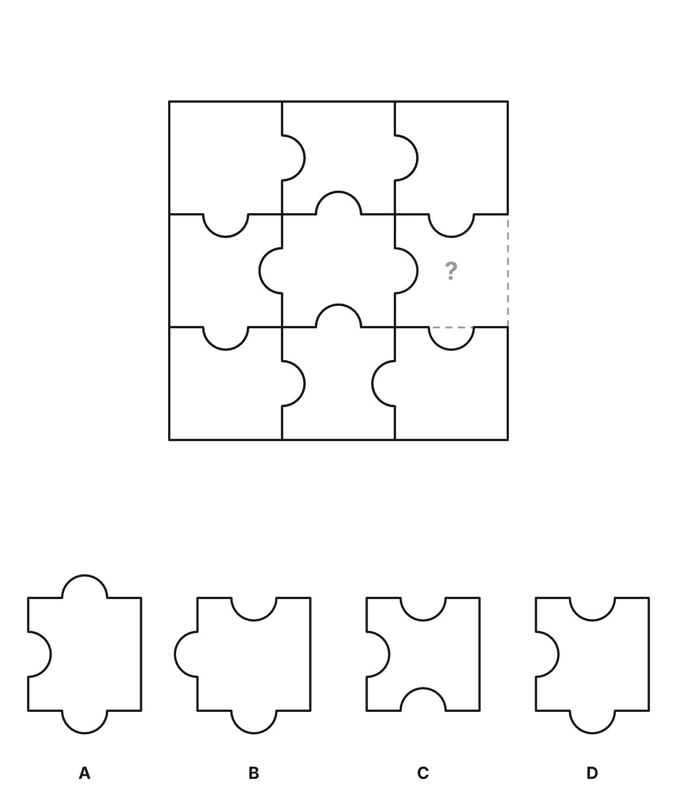
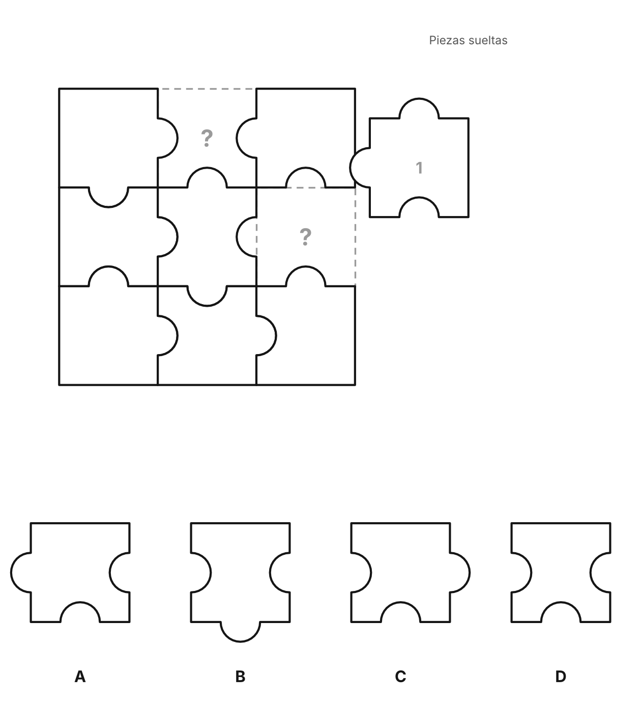
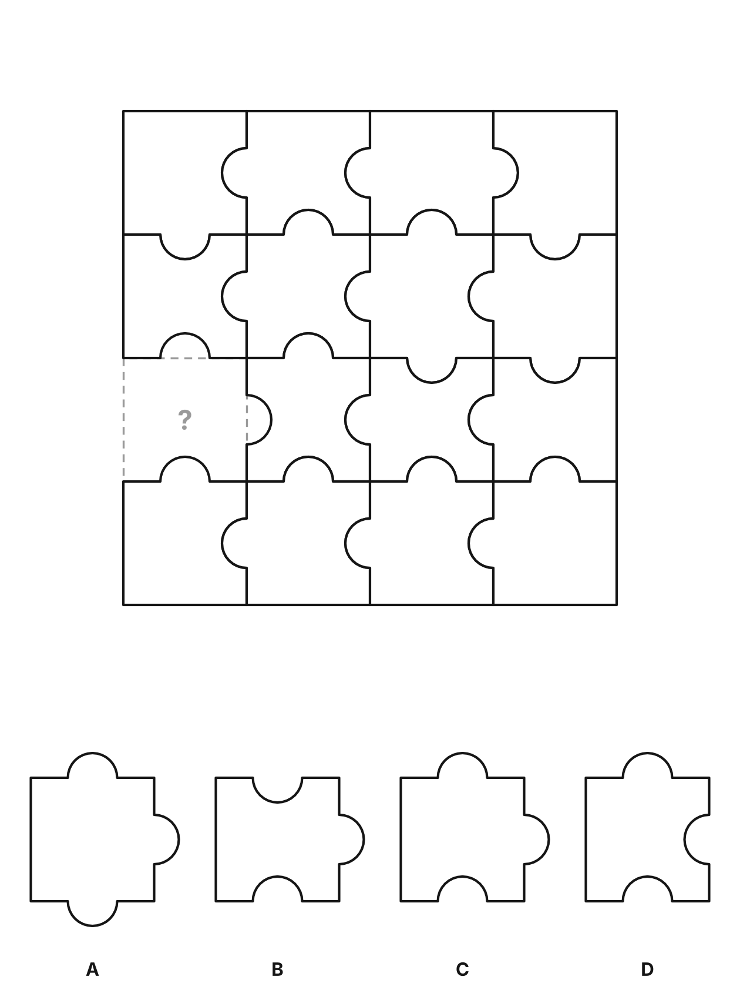
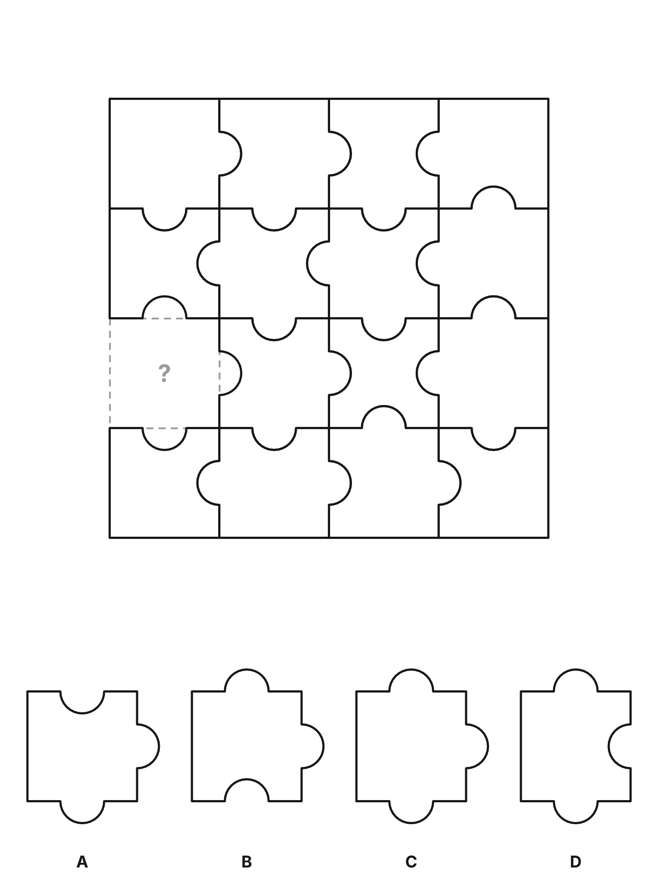
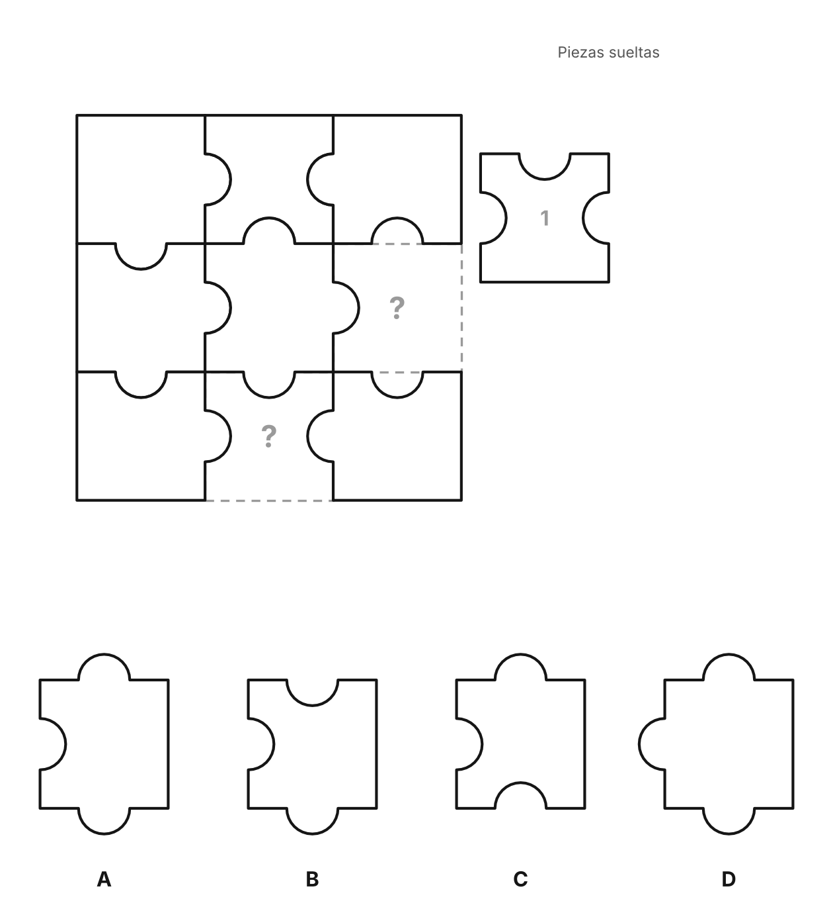

# Puzzles

5 ejercicios · fácil: 0 · media: 5 · difícil: 0

## 187aa2ca42 · media · puzzle_hueco
*Test 030 (2026-11-26), ejercicio 31*

Puzzle de 3×3. ¿Qué pieza completa el puzzle?

**Respuesta: D.** El hueco está en la fila 2, columna 3. Cada borde de la pieza debe ser el opuesto al de la vecina (saliente con entrante) y los del marco son planos: arriba entrante, la derecha plano, abajo saliente, la izquierda entrante.

## c241851662 · media · puzzle_sueltas
*Test 030 (2026-11-26), ejercicio 33*

Puzzle de 3×3. En el puzzle faltan 2 piezas. Coloca las 1 pieza suelta y elige la pieza que falta por colocar.

**Respuesta: D.** Coloca cada pieza suelta donde encaje (la 1 en la fila 2, columna 3). El hueco que queda es el de la fila 1, columna 2: cada borde debe ser el opuesto al de su vecina (saliente con entrante) y los bordes del marco son planos. Pieza que falta: arriba plano, la derecha entrante, abajo entrante, la izquierda entrante.

## 8238ce3b07 · media · puzzle_hueco
*Test 030 (2026-11-26), ejercicio 38*

Puzzle de 4×4. ¿Qué pieza completa el puzzle?

**Respuesta: C.** El hueco está en la fila 3, columna 1. Cada borde de la pieza debe ser el opuesto al de la vecina (saliente con entrante) y los del marco son planos: arriba saliente, la derecha saliente, abajo entrante, la izquierda plano.

## fdc61235fe · media · puzzle_hueco
*Test 030 (2026-11-26), ejercicio 39*

Puzzle de 4×4. ¿Qué pieza completa el puzzle?

**Respuesta: C.** El hueco está en la fila 3, columna 1. Cada borde de la pieza debe ser el opuesto al de la vecina (saliente con entrante) y los del marco son planos: arriba saliente, la derecha saliente, abajo saliente, la izquierda plano.

## 7cff3f056d · media · puzzle_sueltas
*Test 030 (2026-11-26), ejercicio 41*

Puzzle de 3×3. En el puzzle faltan 2 piezas. Coloca las 1 pieza suelta y elige la pieza que falta por colocar.

**Respuesta: A.** Coloca cada pieza suelta donde encaje (la 1 en la fila 3, columna 2). El hueco que queda es el de la fila 2, columna 3: cada borde debe ser el opuesto al de su vecina (saliente con entrante) y los bordes del marco son planos. Pieza que falta: arriba saliente, la derecha plano, abajo saliente, la izquierda entrante.
