# Series de fichas

42 ejercicios · fácil: 15 · media: 10 · difícil: 17

## c8c6dc22f1 · fácil · domino_fila
*Test 010 (2026-11-06), ejercicio 33*

¿Qué ficha de dominó continúa la serie? (en fila)

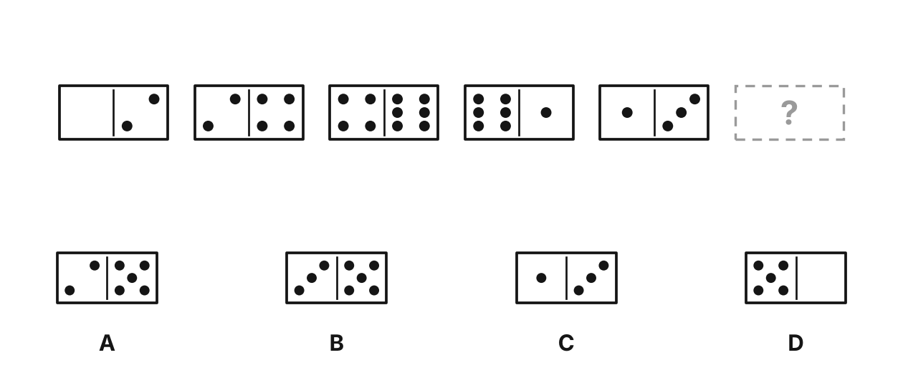

**Respuesta: B.** Mira cada mitad por separado: las dos mitades suben 2 en cada paso (los puntos vuelven a 0 después del 6). La ficha que falta es 3–5.

## 5ec4e809ad · difícil · domino_espiral
*Test 010 (2026-11-06), ejercicio 34*

¿Qué ficha de dominó continúa la serie? (en espiral, desde la ficha de inicio hacia fuera)

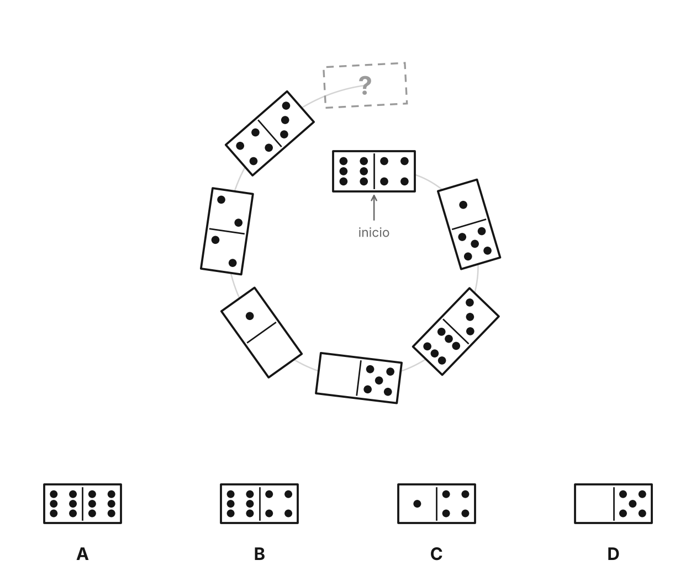

**Respuesta: B.** Mira cada mitad por separado: la mitad izquierda sube 2 y la derecha sube 1 en cada paso (los puntos vuelven a 0 después del 6). La ficha que falta es 6–4.

## 5e5091d593 · fácil · domino_fila
*Test 010 (2026-11-06), ejercicio 35*

¿Qué ficha de dominó continúa la serie? (en fila)

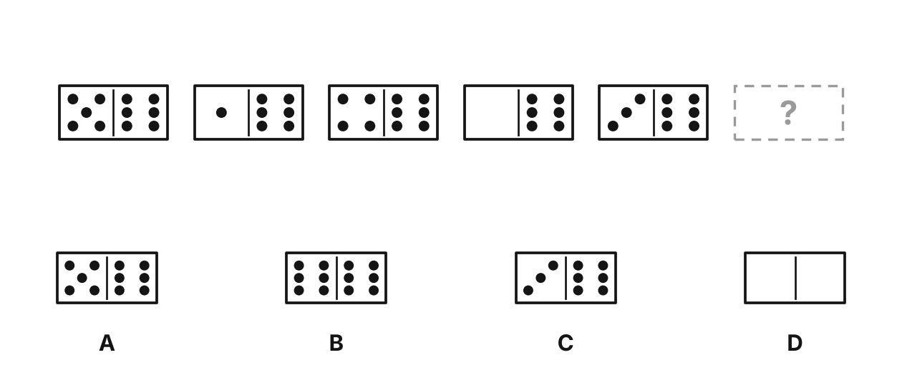

**Respuesta: B.** Mira cada mitad por separado: la mitad izquierda sube 3 y la derecha se queda igual en cada paso (los puntos vuelven a 0 después del 6). La ficha que falta es 6–6.

## ed883bd1bf · media · domino_dos_filas
*Test 010 (2026-11-06), ejercicio 36*

¿Qué ficha de dominó continúa la serie? (en dos filas, de izquierda a derecha y de arriba abajo)

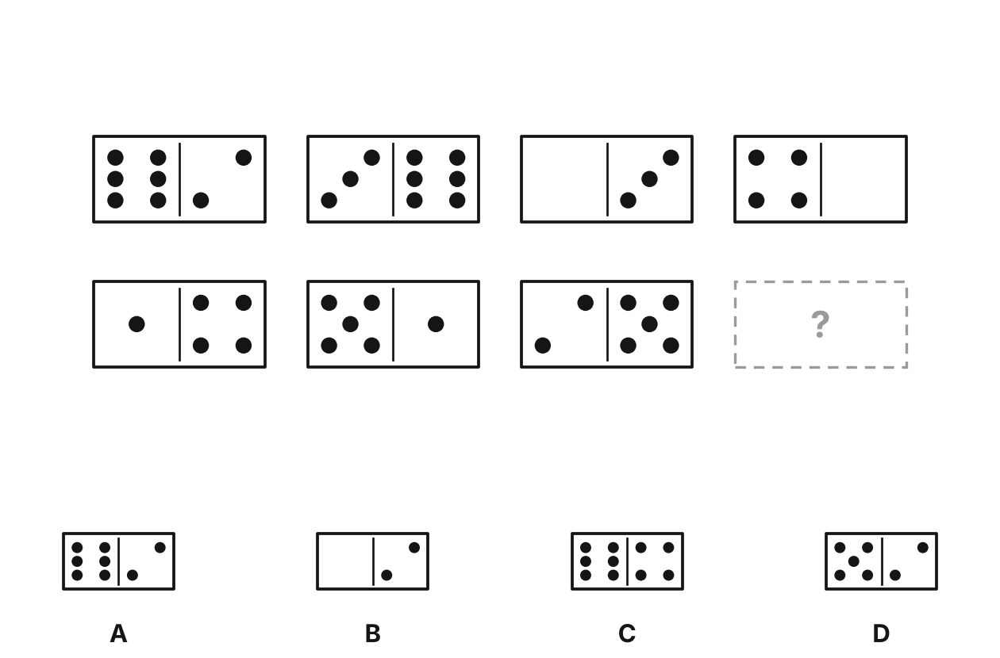

**Respuesta: A.** Mira cada mitad por separado: las dos mitades bajan 3 en cada paso (los puntos vuelven a 0 después del 6). La ficha que falta es 6–2.

## 1b65298bff · media · domino_dos_filas
*Test 012 (2026-11-08), ejercicio 31*

¿Qué ficha de dominó continúa la serie? (en dos filas, de izquierda a derecha y de arriba abajo)

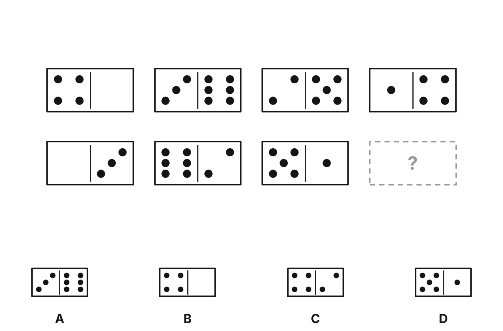

**Respuesta: B.** Mira cada mitad por separado: las dos mitades bajan 1 en cada paso (los puntos vuelven a 0 después del 6). La ficha que falta es 4–0.

## 40981c5932 · difícil · domino_espiral
*Test 012 (2026-11-08), ejercicio 32*

¿Qué ficha de dominó continúa la serie? (en espiral, desde la ficha de inicio hacia fuera)

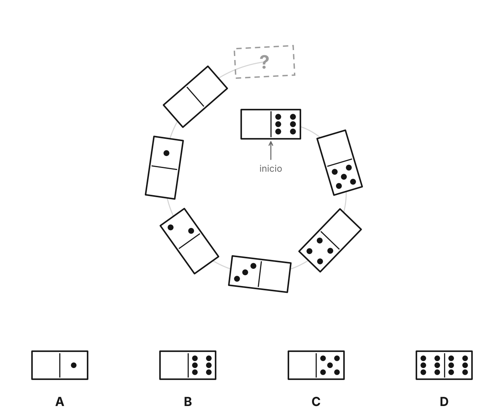

**Respuesta: B.** Mira cada mitad por separado: la mitad izquierda se queda igual y la derecha baja 1 en cada paso (los puntos vuelven a 0 después del 6). La ficha que falta es 0–6.

## dca75533bc · fácil · domino_fila
*Test 012 (2026-11-08), ejercicio 34*

¿Qué ficha de dominó continúa la serie? (en fila)

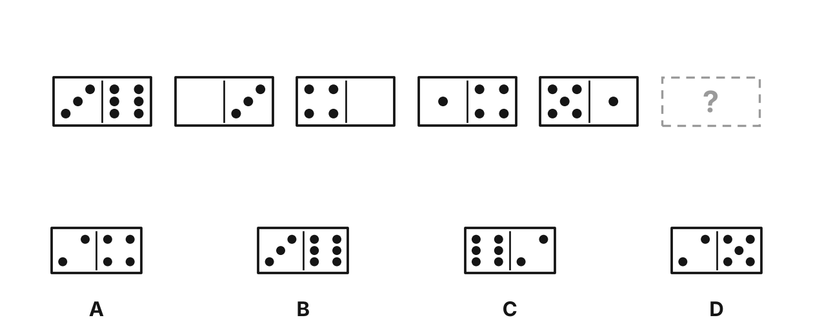

**Respuesta: D.** Mira cada mitad por separado: las dos mitades bajan 3 en cada paso (los puntos vuelven a 0 después del 6). La ficha que falta es 2–5.

## d477ffcfab · media · domino_dos_filas
*Test 012 (2026-11-08), ejercicio 35*

¿Qué ficha de dominó continúa la serie? (en dos filas, de izquierda a derecha y de arriba abajo)

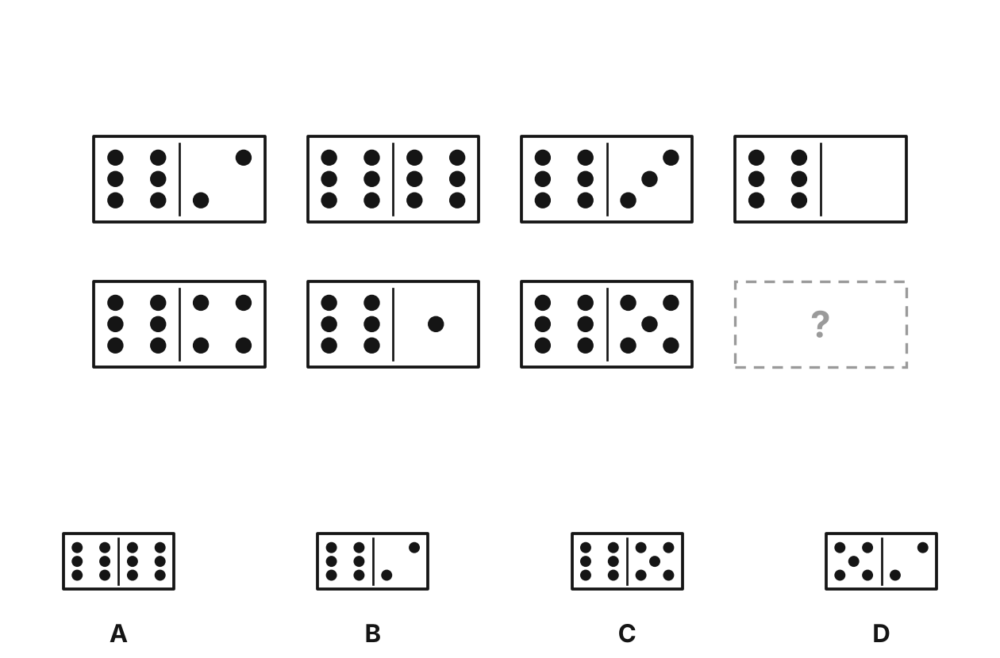

**Respuesta: B.** Mira cada mitad por separado: la mitad izquierda se queda igual y la derecha baja 3 en cada paso (los puntos vuelven a 0 después del 6). La ficha que falta es 6–2.

## 3352482d8c · fácil · domino_fila_vertical
*Test 012 (2026-11-08), ejercicio 38*

¿Qué ficha de dominó continúa la serie? (en fila, con las fichas de pie, de izquierda a derecha)

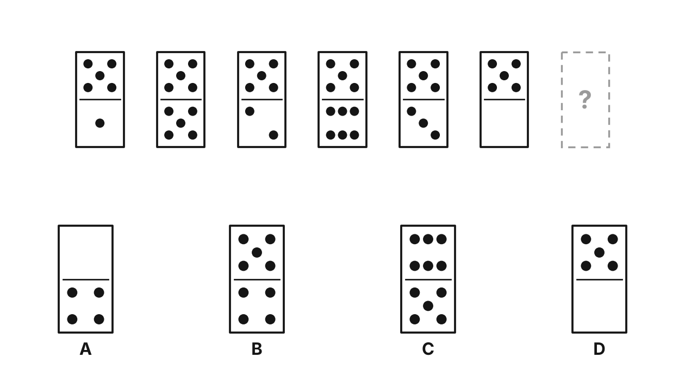

**Respuesta: B.** Mira cada mitad por separado: la mitad superior se queda igual y la inferior baja 3 en cada paso (los puntos vuelven a 0 después del 6). La ficha que falta es 5–4.

## 38e7777da6 · fácil · domino_fila
*Test 013 (2026-11-09), ejercicio 25*

¿Qué ficha de dominó continúa la serie? (en fila)

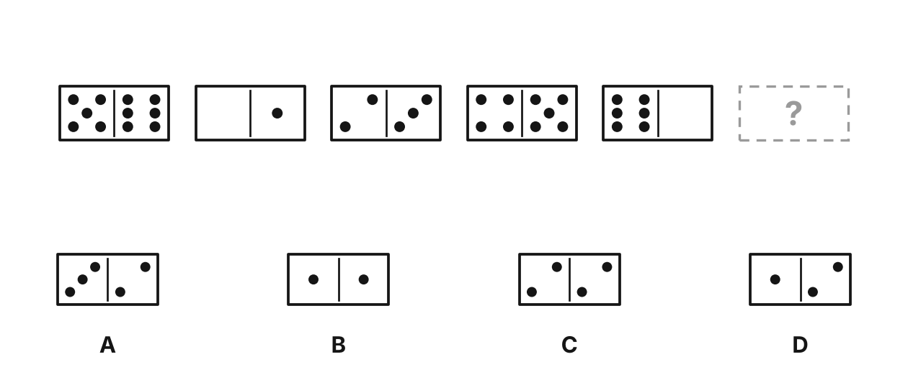

**Respuesta: D.** Mira cada mitad por separado: las dos mitades suben 2 en cada paso (los puntos vuelven a 0 después del 6). La ficha que falta es 1–2.

## 386ee2030f · difícil · domino_circulo
*Test 013 (2026-11-09), ejercicio 27*

¿Qué ficha de dominó continúa la serie? (en círculo, en el sentido de las agujas del reloj desde la ficha de inicio)

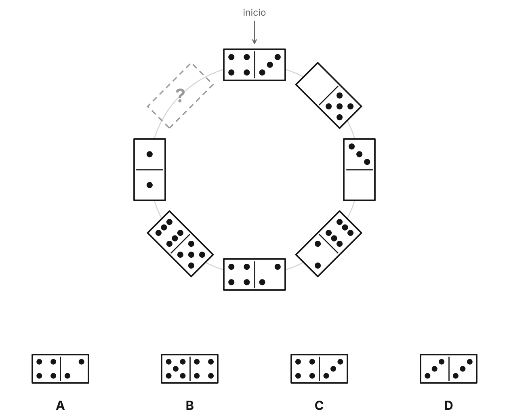

**Respuesta: C.** Mira cada mitad por separado: la mitad izquierda sube 3 y la derecha sube 2 en cada paso (los puntos vuelven a 0 después del 6). La ficha que falta es 4–3.

## 290257566b · difícil · domino_espiral
*Test 013 (2026-11-09), ejercicio 28*

¿Qué ficha de dominó continúa la serie? (en espiral, desde la ficha de inicio hacia fuera)

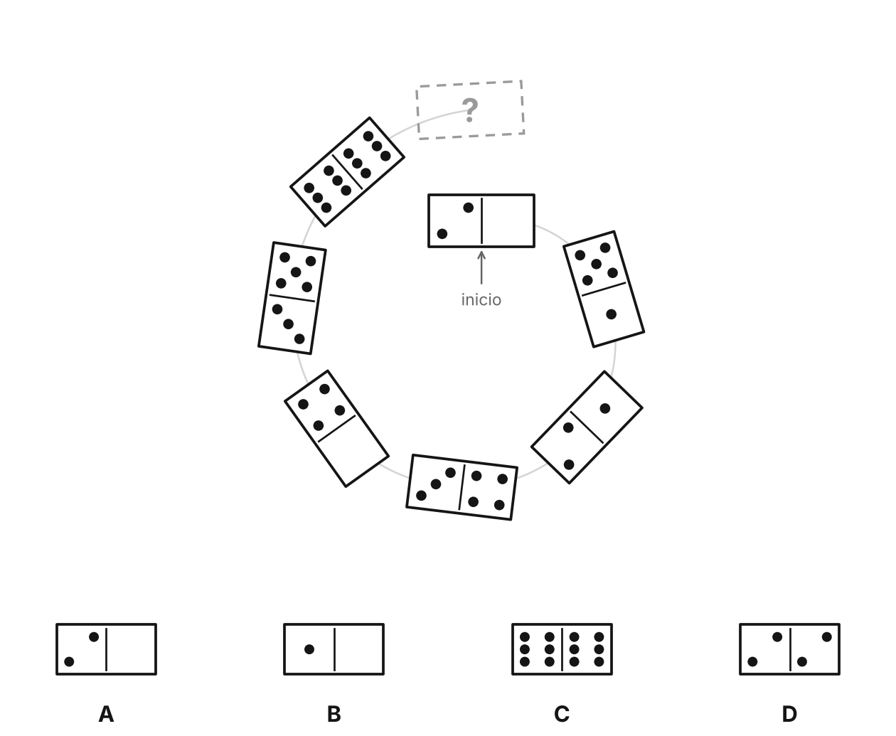

**Respuesta: A.** Mira cada mitad por separado: la mitad izquierda sube 3 y la derecha sube 1 en cada paso (los puntos vuelven a 0 después del 6). La ficha que falta es 2–0.

## b016d8c1c7 · media · domino_dos_filas
*Test 013 (2026-11-09), ejercicio 31*

¿Qué ficha de dominó continúa la serie? (en dos filas, de izquierda a derecha y de arriba abajo)

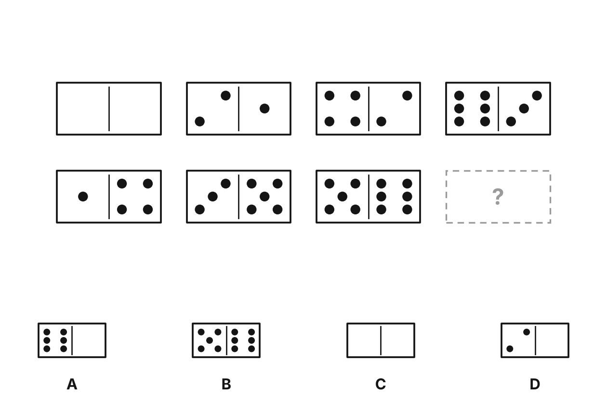

**Respuesta: C.** Mira cada mitad por separado: la mitad izquierda sube 2 y la derecha sube 1 en cada paso (los puntos vuelven a 0 después del 6). La ficha que falta es 0–0.

## e1154eedb3 · media · domino_dos_filas
*Test 015 (2026-11-11), ejercicio 24*

¿Qué ficha de dominó continúa la serie? (en dos filas, de izquierda a derecha y de arriba abajo)

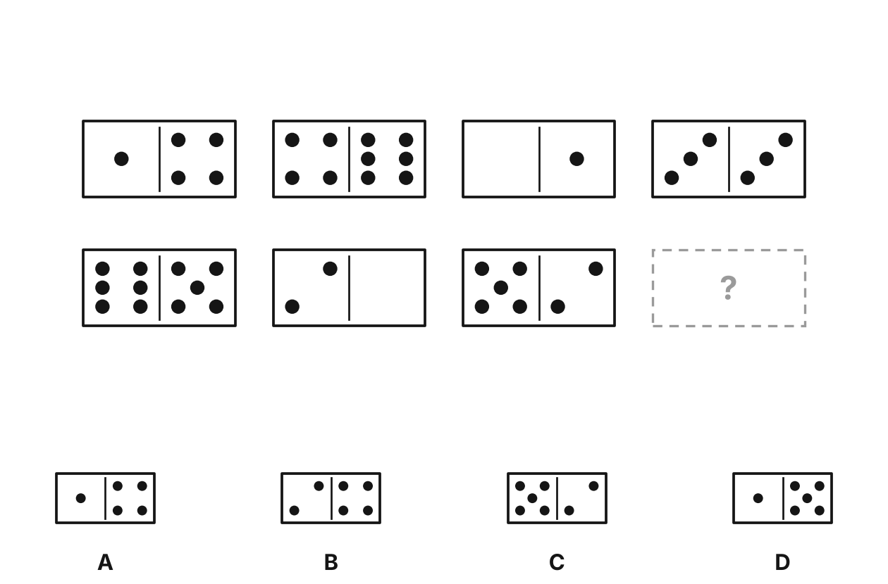

**Respuesta: A.** Mira cada mitad por separado: la mitad izquierda sube 3 y la derecha sube 2 en cada paso (los puntos vuelven a 0 después del 6). La ficha que falta es 1–4.

## 37cffbf455 · difícil · domino_circulo
*Test 015 (2026-11-11), ejercicio 26*

¿Qué ficha de dominó continúa la serie? (en círculo, en el sentido de las agujas del reloj desde la ficha de inicio)

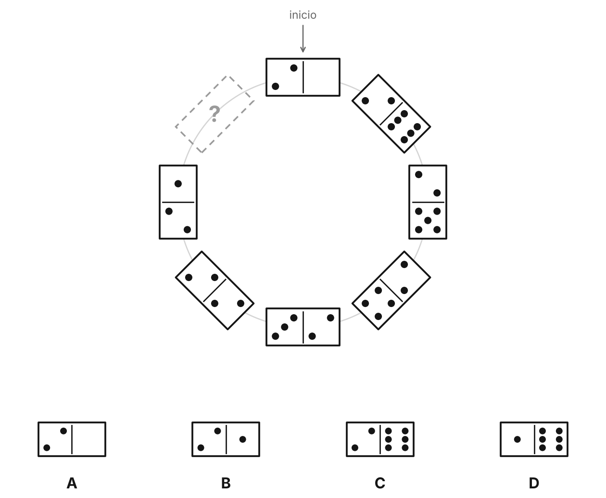

**Respuesta: A.** Mira cada mitad por separado: la mitad izquierda se queda igual y la derecha baja 1 en cada paso (los puntos vuelven a 0 después del 6). La ficha que falta es 2–0.

## e60ef329fe · difícil · domino_circulo
*Test 015 (2026-11-11), ejercicio 30*

¿Qué ficha de dominó continúa la serie? (en círculo, en el sentido de las agujas del reloj desde la ficha de inicio)

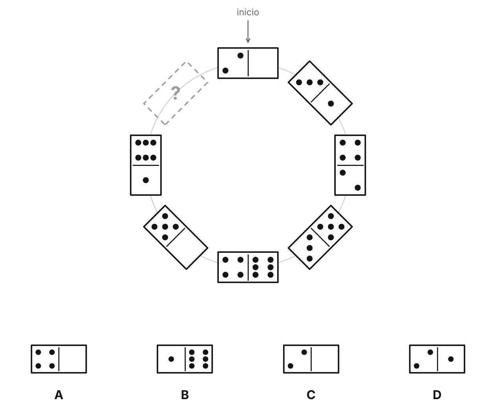

**Respuesta: C.** Mira cada mitad por separado: las dos mitades suben 1 en cada paso (los puntos vuelven a 0 después del 6). La ficha que falta es 2–0.

## ae715a3d88 · fácil · domino_fila
*Test 015 (2026-11-11), ejercicio 31*

¿Qué ficha de dominó continúa la serie? (en fila)

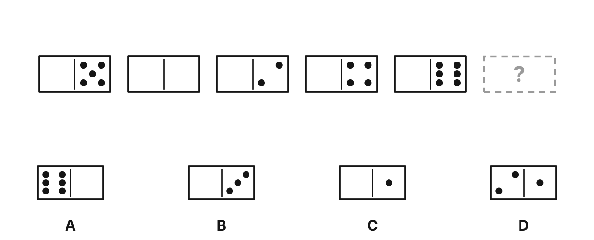

**Respuesta: C.** Mira cada mitad por separado: la mitad izquierda se queda igual y la derecha sube 2 en cada paso (los puntos vuelven a 0 después del 6). La ficha que falta es 0–1.

## 0b141d9282 · difícil · domino_circulo
*Test 016 (2026-11-12), ejercicio 26*

¿Qué ficha de dominó continúa la serie? (en círculo, en el sentido de las agujas del reloj desde la ficha de inicio)

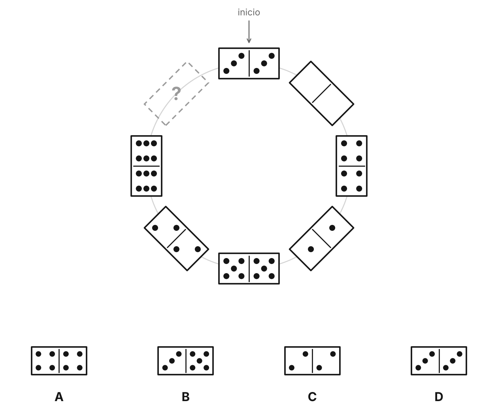

**Respuesta: D.** Mira cada mitad por separado: las dos mitades bajan 3 en cada paso (los puntos vuelven a 0 después del 6). La ficha que falta es 3–3.

## 3eeaebcb6c · media · domino_dos_filas
*Test 016 (2026-11-12), ejercicio 27*

¿Qué ficha de dominó continúa la serie? (en dos filas, de izquierda a derecha y de arriba abajo)

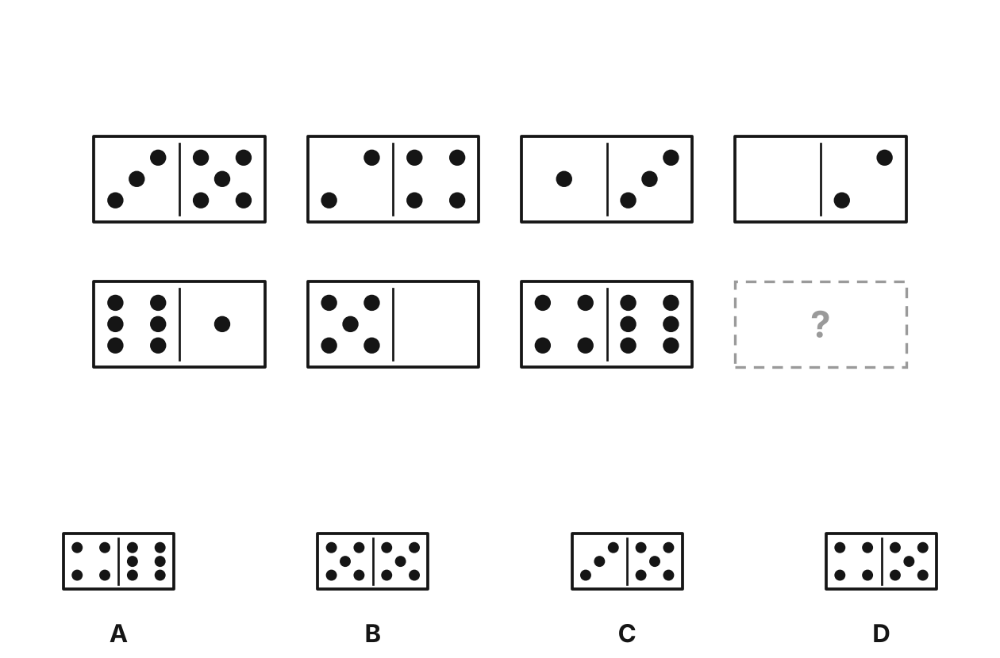

**Respuesta: C.** Mira cada mitad por separado: las dos mitades bajan 1 en cada paso (los puntos vuelven a 0 después del 6). La ficha que falta es 3–5.

## ee1ed15b17 · difícil · domino_espiral
*Test 016 (2026-11-12), ejercicio 30*

¿Qué ficha de dominó continúa la serie? (en espiral, desde la ficha de inicio hacia fuera)

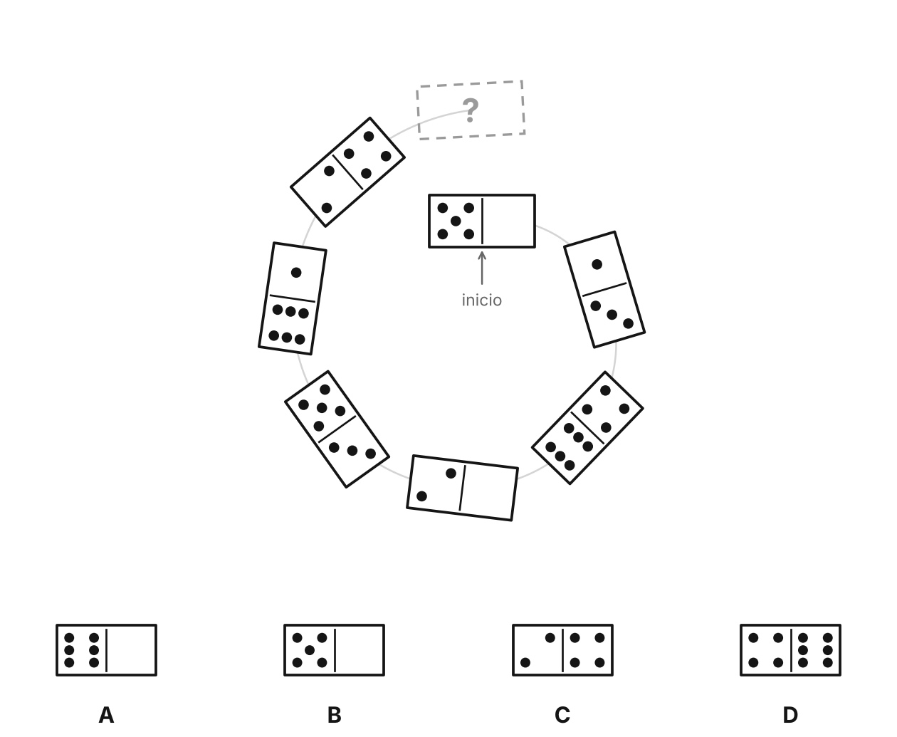

**Respuesta: B.** Mira cada mitad por separado: las dos mitades suben 3 en cada paso (los puntos vuelven a 0 después del 6). La ficha que falta es 5–0.

## e0d1cb0300 · fácil · domino_fila
*Test 016 (2026-11-12), ejercicio 31*

¿Qué ficha de dominó continúa la serie? (en fila)

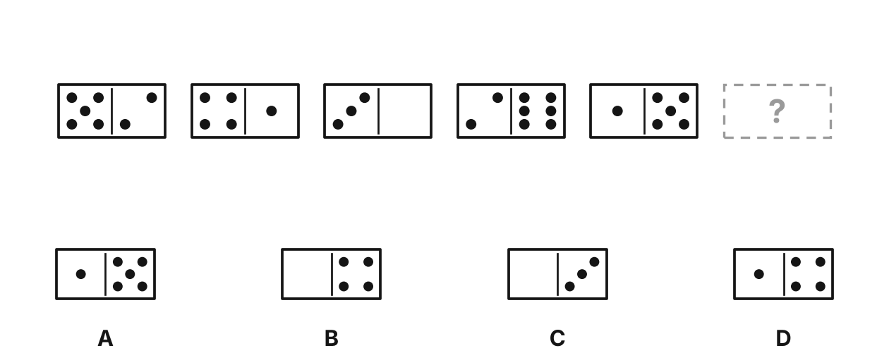

**Respuesta: B.** Mira cada mitad por separado: las dos mitades bajan 1 en cada paso (los puntos vuelven a 0 después del 6). La ficha que falta es 0–4.

## 72635588fd · difícil · domino_circulo
*Test 019 (2026-11-15), ejercicio 26*

¿Qué ficha de dominó continúa la serie? (en círculo, en el sentido de las agujas del reloj desde la ficha de inicio)

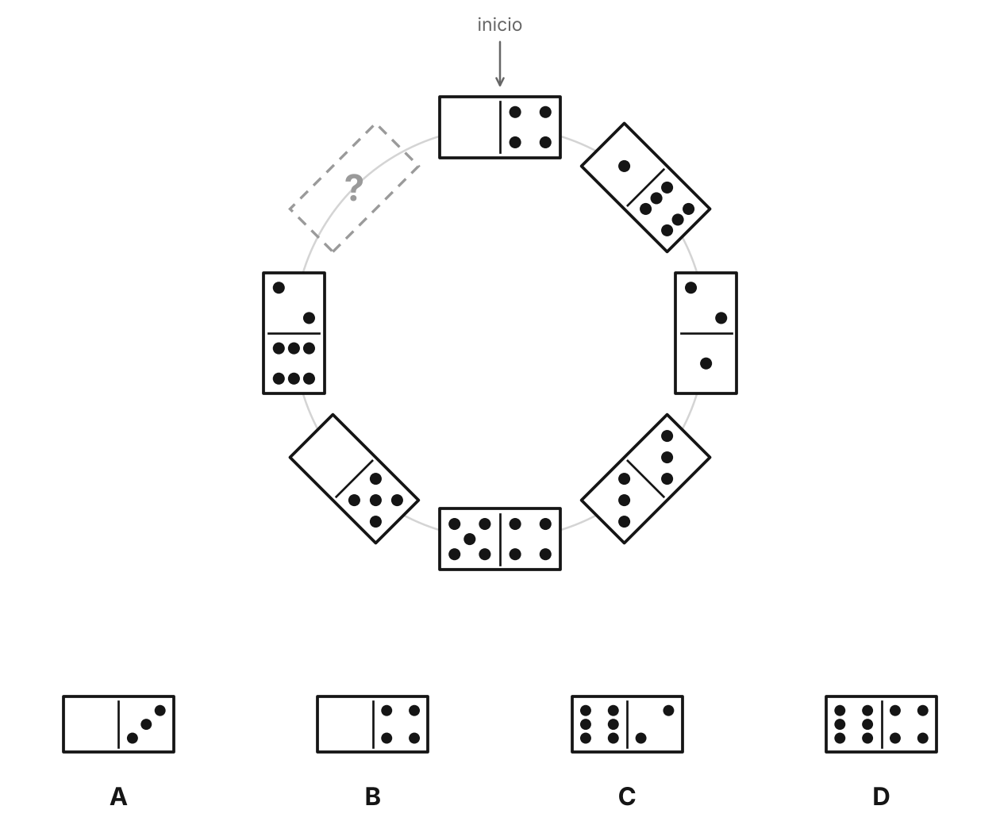

**Respuesta: B.** Mira cada mitad por separado: la mitad izquierda sube 1 y la derecha sube 2 en cada paso (los puntos vuelven a 0 después del 6). La ficha que falta es 0–4.

## 4314934c74 · difícil · domino_espiral
*Test 019 (2026-11-15), ejercicio 27*

¿Qué ficha de dominó continúa la serie? (en espiral, desde la ficha de inicio hacia fuera)

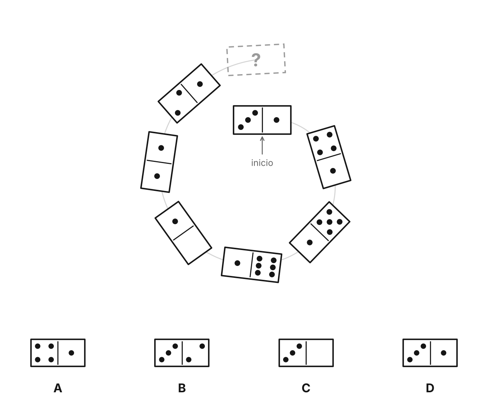

**Respuesta: D.** Mira cada mitad por separado: la mitad izquierda sube 1 y la derecha se queda igual en cada paso (los puntos vuelven a 0 después del 6). La ficha que falta es 3–1.

## c1a96c16f0 · difícil · domino_circulo
*Test 019 (2026-11-15), ejercicio 28*

¿Qué ficha de dominó continúa la serie? (en círculo, en el sentido de las agujas del reloj desde la ficha de inicio)

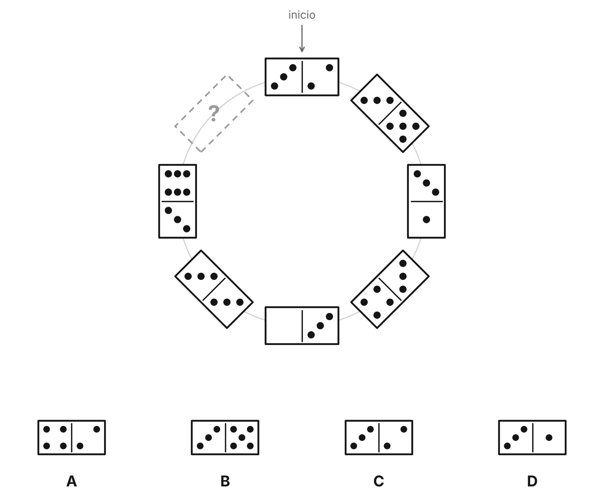

**Respuesta: C.** Mira cada mitad por separado: la mitad izquierda se queda igual y la derecha sube 3 en cada paso (los puntos vuelven a 0 después del 6). La ficha que falta es 3–2.

## 8143bd4c9f · media · domino_dos_filas
*Test 019 (2026-11-15), ejercicio 29*

¿Qué ficha de dominó continúa la serie? (en dos filas, de izquierda a derecha y de arriba abajo)

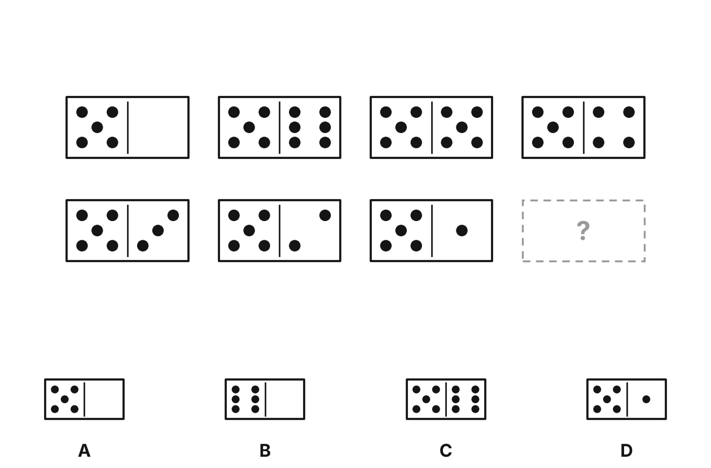

**Respuesta: A.** Mira cada mitad por separado: la mitad izquierda se queda igual y la derecha baja 1 en cada paso (los puntos vuelven a 0 después del 6). La ficha que falta es 5–0.

## f63d75ceff · fácil · domino_fila_vertical
*Test 021 (2026-11-17), ejercicio 29*

¿Qué ficha de dominó continúa la serie? (en fila, con las fichas de pie, de izquierda a derecha)

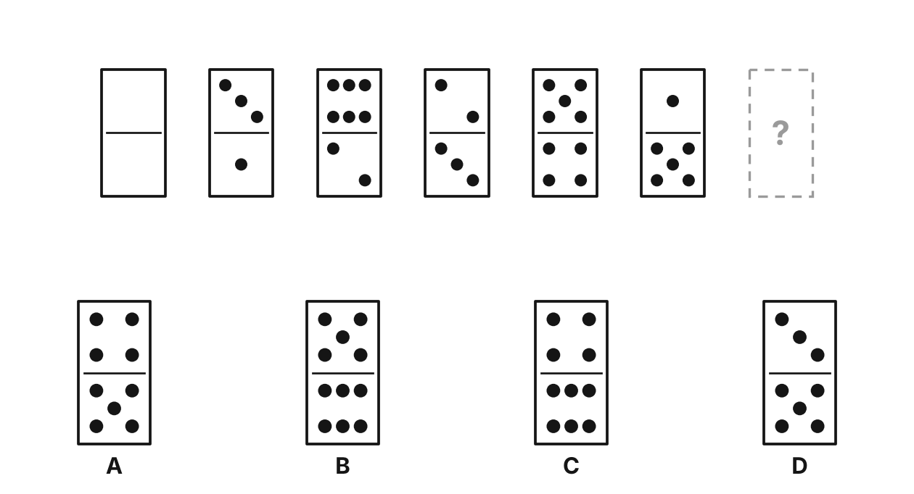

**Respuesta: C.** Mira cada mitad por separado: la mitad superior sube 3 y la inferior sube 1 en cada paso (los puntos vuelven a 0 después del 6). La ficha que falta es 4–6.

## 1c52a5fbb3 · media · domino_dos_filas
*Test 021 (2026-11-17), ejercicio 30*

¿Qué ficha de dominó continúa la serie? (en dos filas, de izquierda a derecha y de arriba abajo)

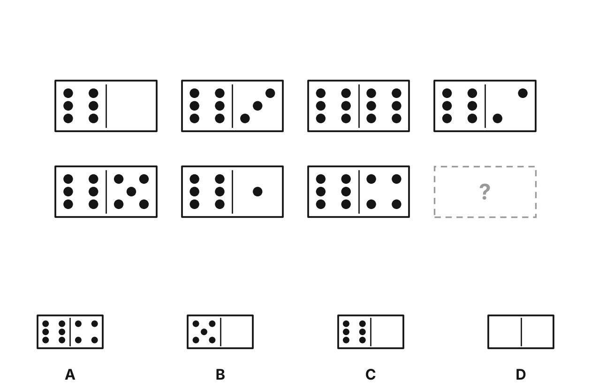

**Respuesta: C.** Mira cada mitad por separado: la mitad izquierda se queda igual y la derecha sube 3 en cada paso (los puntos vuelven a 0 después del 6). La ficha que falta es 6–0.

## 059ba03581 · difícil · domino_espiral
*Test 021 (2026-11-17), ejercicio 31*

¿Qué ficha de dominó continúa la serie? (en espiral, desde la ficha de inicio hacia fuera)

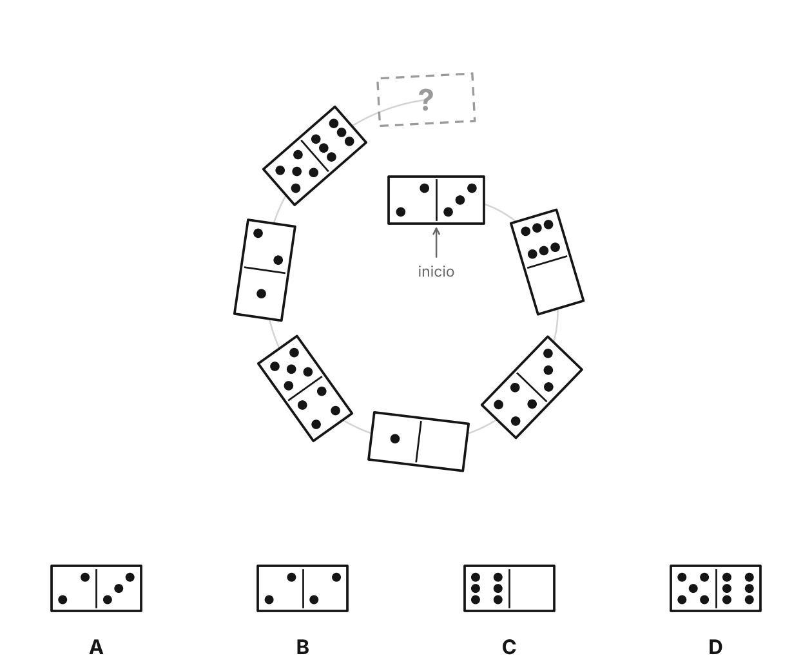

**Respuesta: A.** Mira cada mitad por separado: las dos mitades bajan 3 en cada paso (los puntos vuelven a 0 después del 6). La ficha que falta es 2–3.

## b4a959e9e7 · fácil · domino_fila
*Test 021 (2026-11-17), ejercicio 33*

¿Qué ficha de dominó continúa la serie? (en fila)

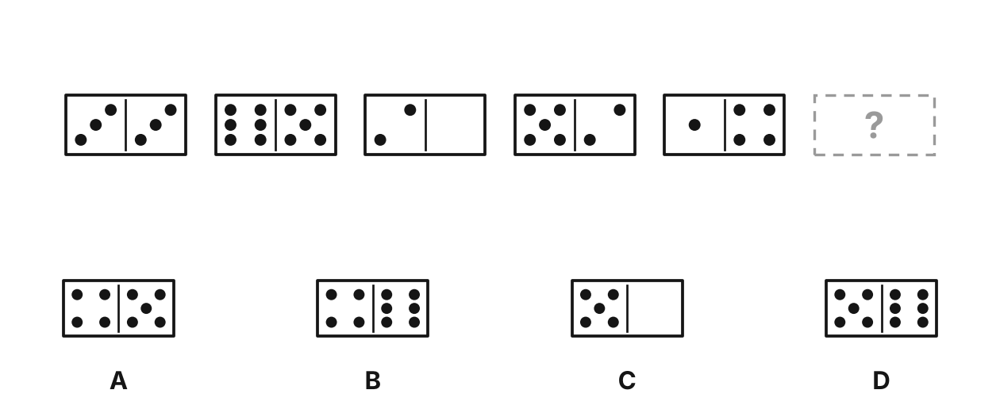

**Respuesta: B.** Mira cada mitad por separado: la mitad izquierda sube 3 y la derecha sube 2 en cada paso (los puntos vuelven a 0 después del 6). La ficha que falta es 4–6.

## 993025284a · fácil · domino_fila_vertical
*Test 022 (2026-11-18), ejercicio 30*

¿Qué ficha de dominó continúa la serie? (en fila, con las fichas de pie, de izquierda a derecha)

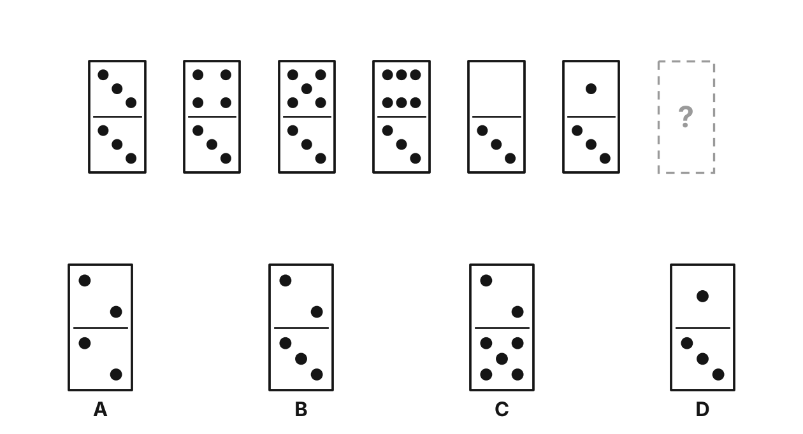

**Respuesta: B.** Mira cada mitad por separado: la mitad superior sube 1 y la inferior se queda igual en cada paso (los puntos vuelven a 0 después del 6). La ficha que falta es 2–3.

## 1e70625a57 · fácil · domino_fila_vertical
*Test 022 (2026-11-18), ejercicio 33*

¿Qué ficha de dominó continúa la serie? (en fila, con las fichas de pie, de izquierda a derecha)

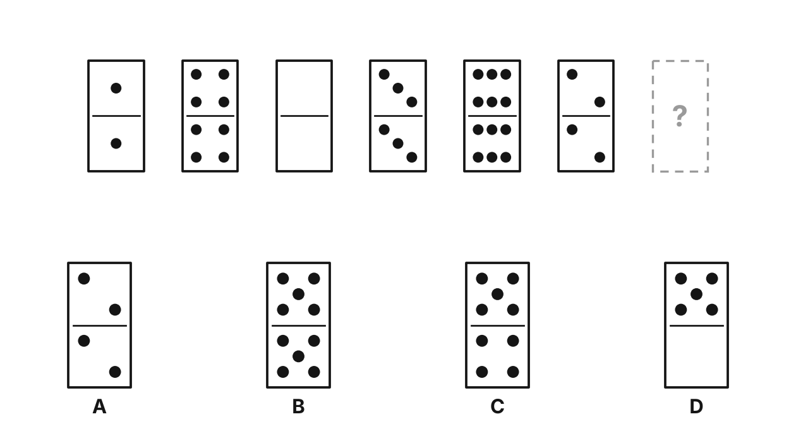

**Respuesta: B.** Mira cada mitad por separado: las dos mitades suben 3 en cada paso (los puntos vuelven a 0 después del 6). La ficha que falta es 5–5.

## 35e71908ac · difícil · domino_circulo
*Test 022 (2026-11-18), ejercicio 34*

¿Qué ficha de dominó continúa la serie? (en círculo, en el sentido de las agujas del reloj desde la ficha de inicio)

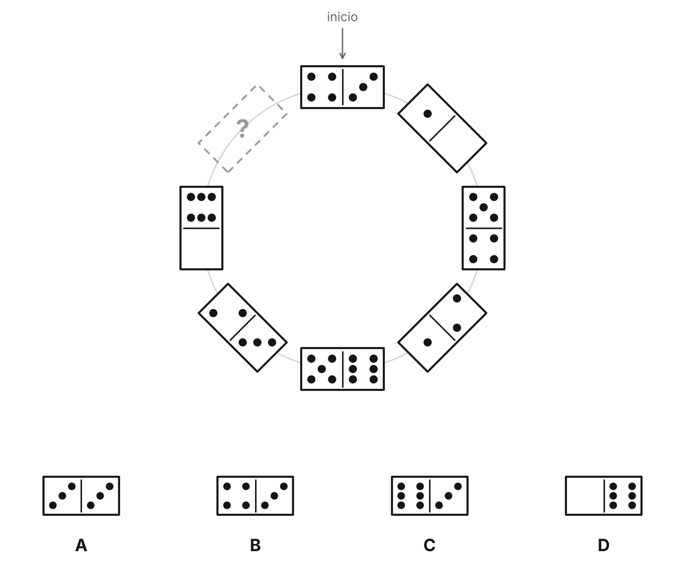

**Respuesta: B.** Mira cada mitad por separado: las dos mitades bajan 3 en cada paso (los puntos vuelven a 0 después del 6). La ficha que falta es 4–3.

## ff79cf3c93 · difícil · domino_circulo
*Test 022 (2026-11-18), ejercicio 38*

¿Qué ficha de dominó continúa la serie? (en círculo, en el sentido de las agujas del reloj desde la ficha de inicio)

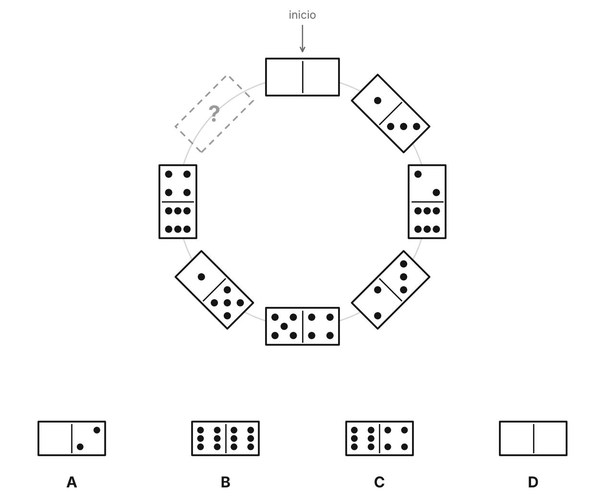

**Respuesta: D.** Mira cada mitad por separado: la mitad izquierda sube 1 y la derecha sube 3 en cada paso (los puntos vuelven a 0 después del 6). La ficha que falta es 0–0.

## 7ddf0a61c8 · fácil · domino_fila_vertical
*Test 024 (2026-11-20), ejercicio 31*

¿Qué ficha de dominó continúa la serie? (en fila, con las fichas de pie, de izquierda a derecha)

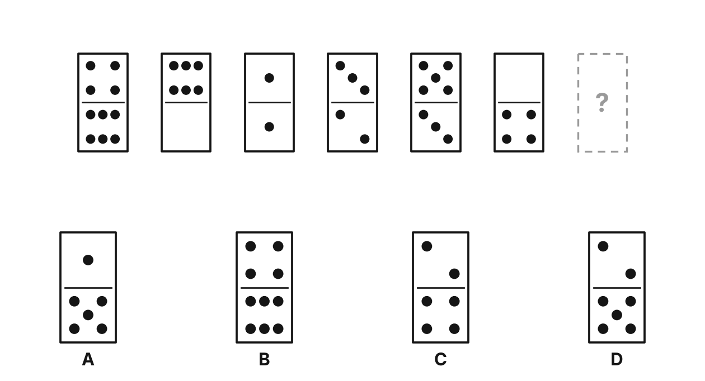

**Respuesta: D.** Mira cada mitad por separado: la mitad superior sube 2 y la inferior sube 1 en cada paso (los puntos vuelven a 0 después del 6). La ficha que falta es 2–5.

## 153e7f8358 · difícil · domino_espiral
*Test 024 (2026-11-20), ejercicio 34*

¿Qué ficha de dominó continúa la serie? (en espiral, desde la ficha de inicio hacia fuera)

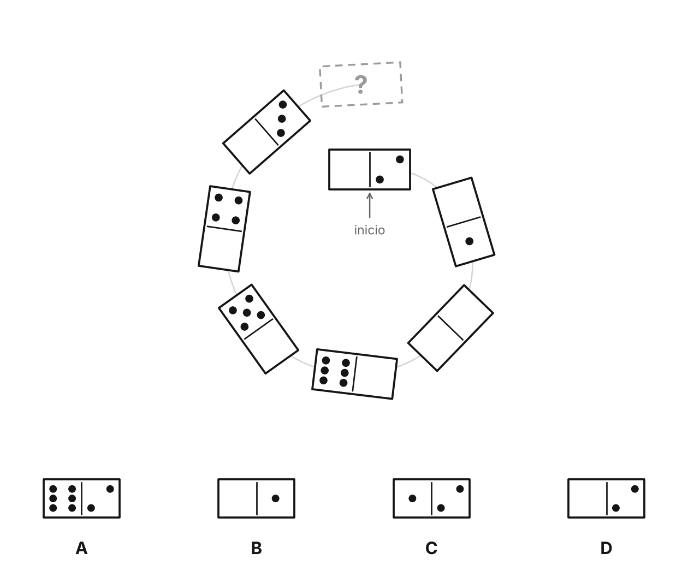

**Respuesta: D.** Mira cada mitad por separado: la mitad izquierda se queda igual y la derecha baja 1 en cada paso (los puntos vuelven a 0 después del 6). La ficha que falta es 0–2.

## 508e7740de · media · domino_dos_filas
*Test 024 (2026-11-20), ejercicio 35*

¿Qué ficha de dominó continúa la serie? (en dos filas, de izquierda a derecha y de arriba abajo)

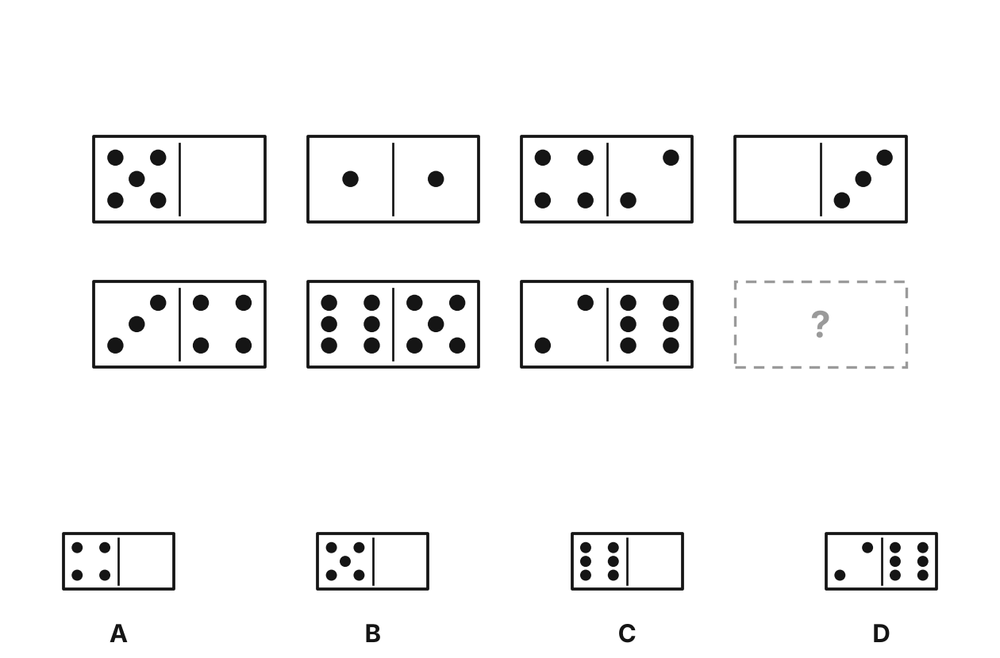

**Respuesta: B.** Mira cada mitad por separado: la mitad izquierda sube 3 y la derecha sube 1 en cada paso (los puntos vuelven a 0 después del 6). La ficha que falta es 5–0.

## 2572897db3 · fácil · domino_fila
*Test 024 (2026-11-20), ejercicio 36*

¿Qué ficha de dominó continúa la serie? (en fila)

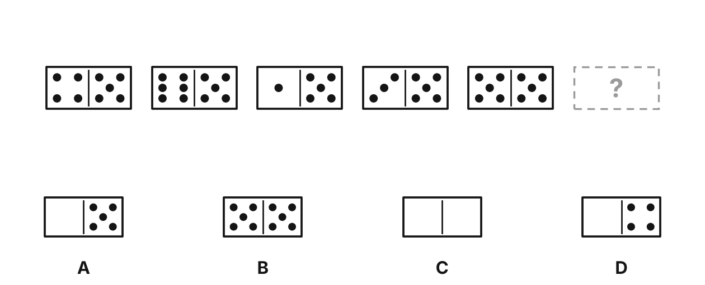

**Respuesta: A.** Mira cada mitad por separado: la mitad izquierda sube 2 y la derecha se queda igual en cada paso (los puntos vuelven a 0 después del 6). La ficha que falta es 0–5.

## 3f887700f3 · difícil · domino_circulo
*Test 024 (2026-11-20), ejercicio 37*

¿Qué ficha de dominó continúa la serie? (en círculo, en el sentido de las agujas del reloj desde la ficha de inicio)

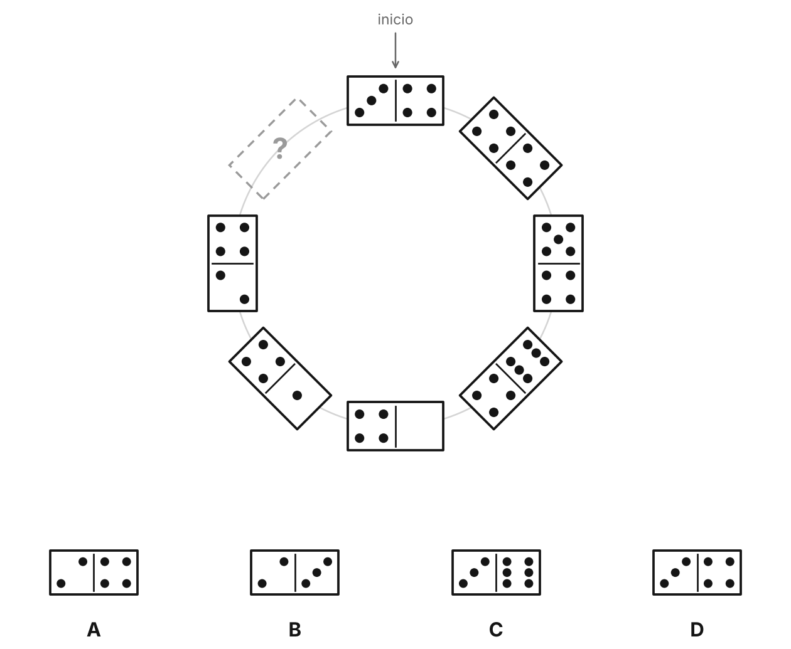

**Respuesta: D.** Mira cada mitad por separado: la mitad izquierda sube 1 y la derecha se queda igual en cada paso (los puntos vuelven a 0 después del 6). La ficha que falta es 3–4.

## 3bba444995 · media · domino_dos_filas
*Test 027 (2026-11-23), ejercicio 24*

¿Qué ficha de dominó continúa la serie? (en dos filas, de izquierda a derecha y de arriba abajo)

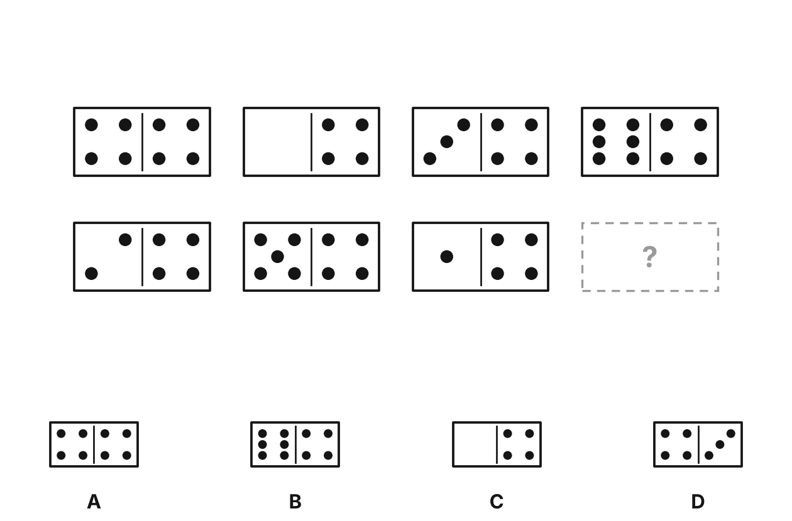

**Respuesta: A.** Mira cada mitad por separado: la mitad izquierda sube 3 y la derecha se queda igual en cada paso (los puntos vuelven a 0 después del 6). La ficha que falta es 4–4.

## d3eabdc6a2 · fácil · domino_fila
*Test 027 (2026-11-23), ejercicio 27*

¿Qué ficha de dominó continúa la serie? (en fila)

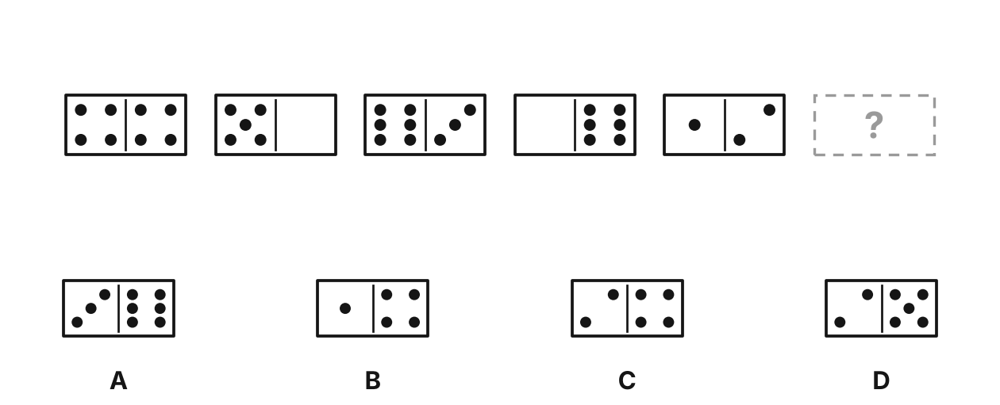

**Respuesta: D.** Mira cada mitad por separado: la mitad izquierda sube 1 y la derecha sube 3 en cada paso (los puntos vuelven a 0 después del 6). La ficha que falta es 2–5.

## f15eaa24e2 · fácil · domino_fila
*Test 027 (2026-11-23), ejercicio 28*

¿Qué ficha de dominó continúa la serie? (en fila)

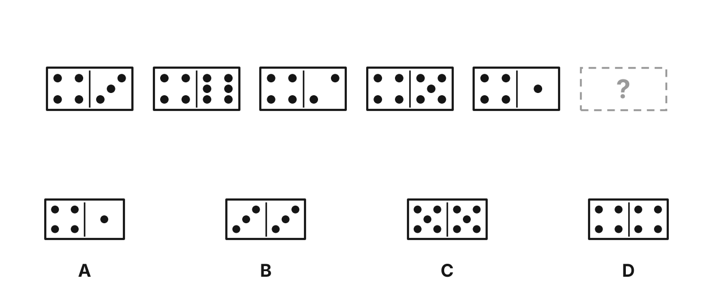

**Respuesta: D.** Mira cada mitad por separado: la mitad izquierda se queda igual y la derecha sube 3 en cada paso (los puntos vuelven a 0 después del 6). La ficha que falta es 4–4.

## 5998ef7fce · difícil · domino_circulo
*Test 027 (2026-11-23), ejercicio 29*

¿Qué ficha de dominó continúa la serie? (en círculo, en el sentido de las agujas del reloj desde la ficha de inicio)

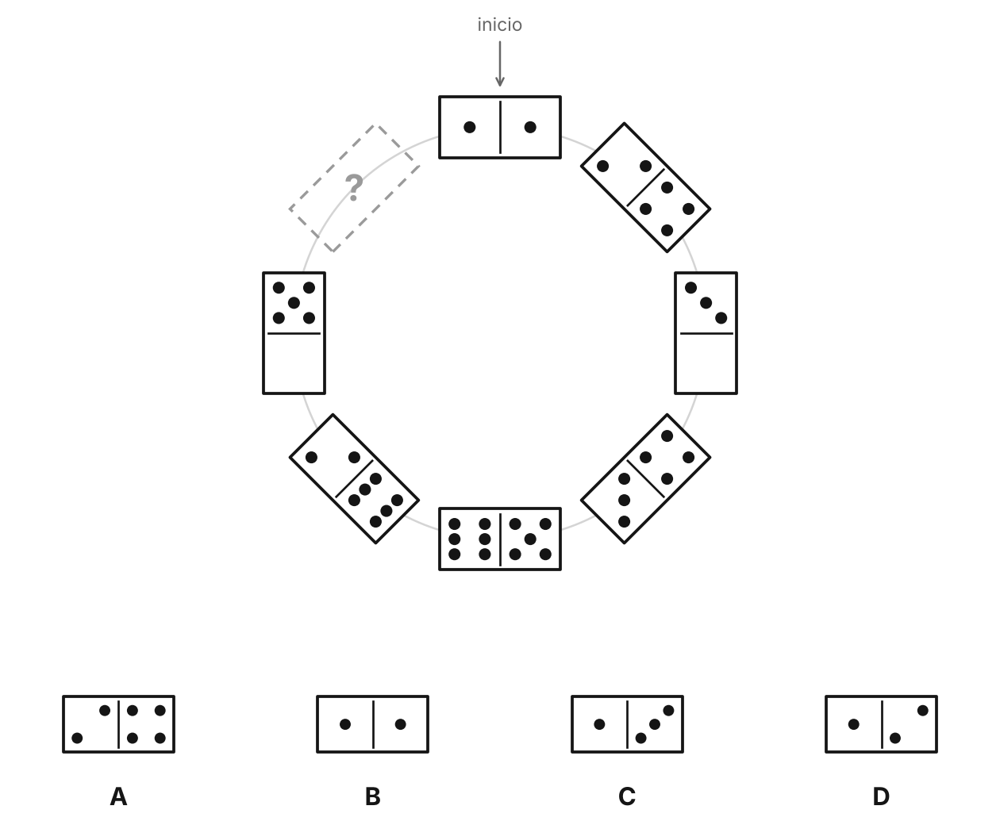

**Respuesta: B.** Mira cada mitad por separado: la mitad izquierda sube 1 y la derecha sube 3 en cada paso (los puntos vuelven a 0 después del 6). La ficha que falta es 1–1.
