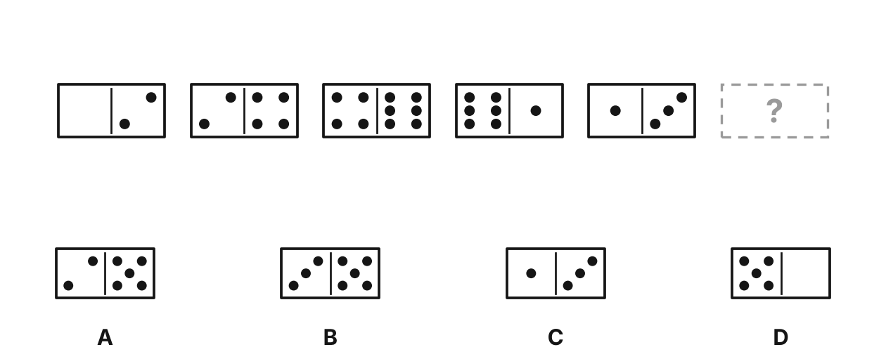
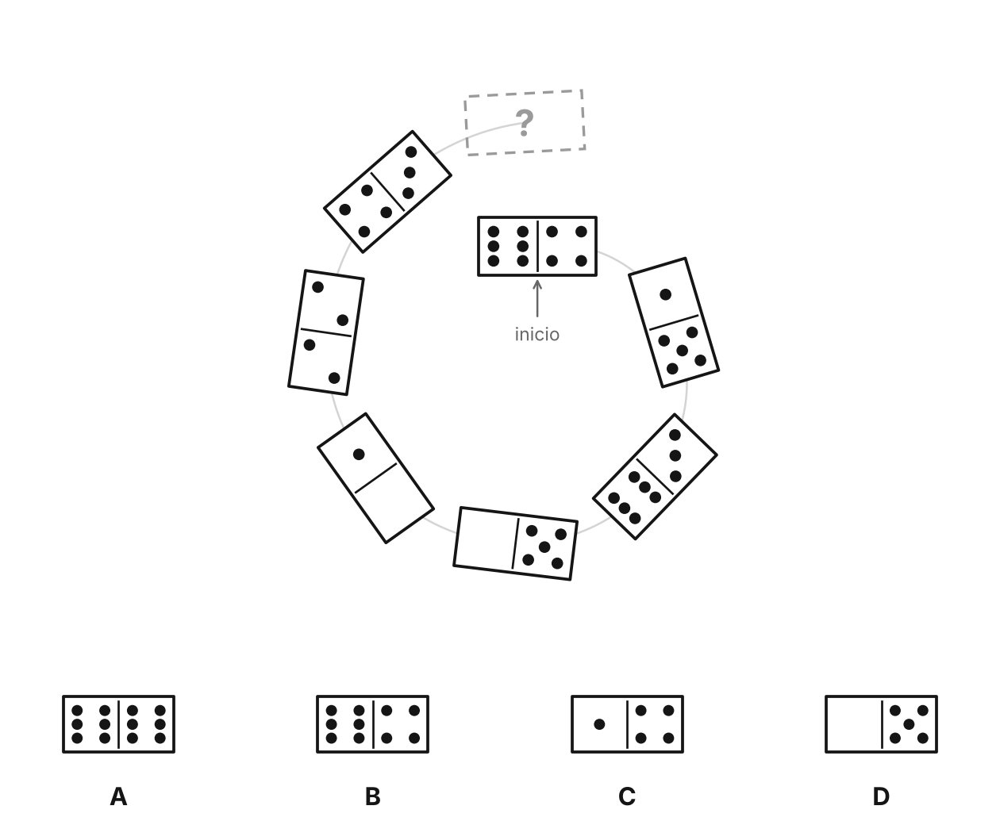
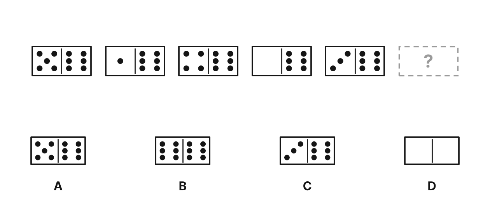
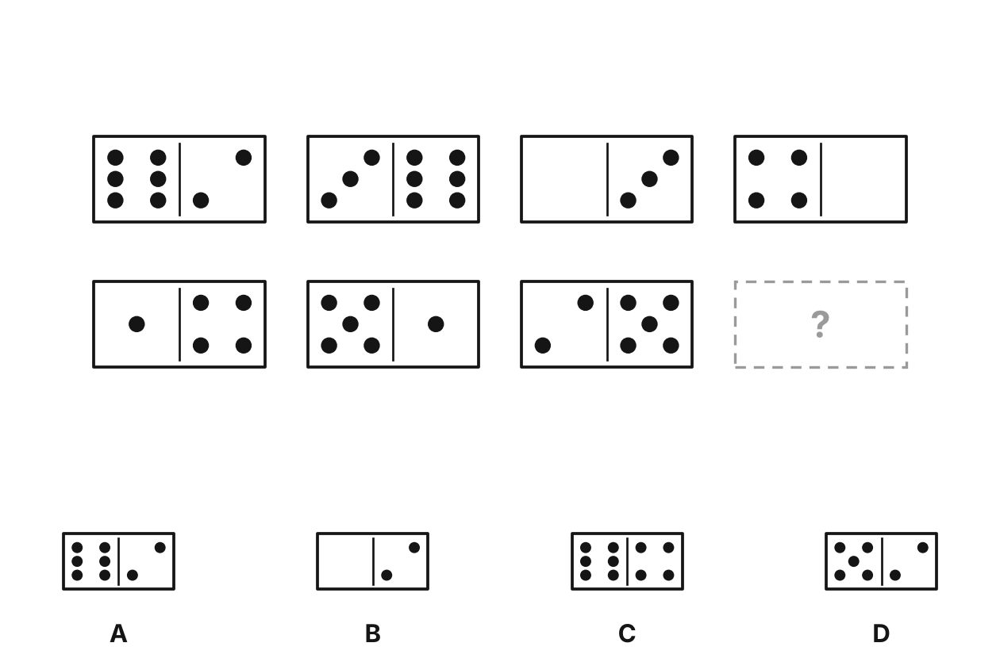
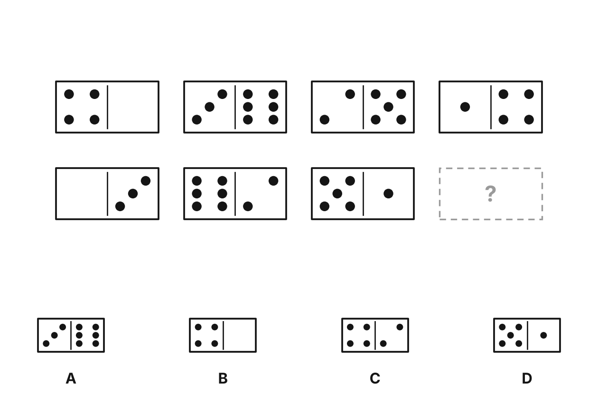
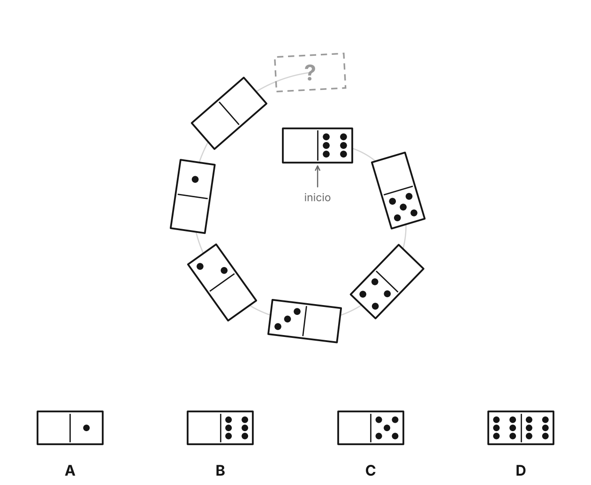
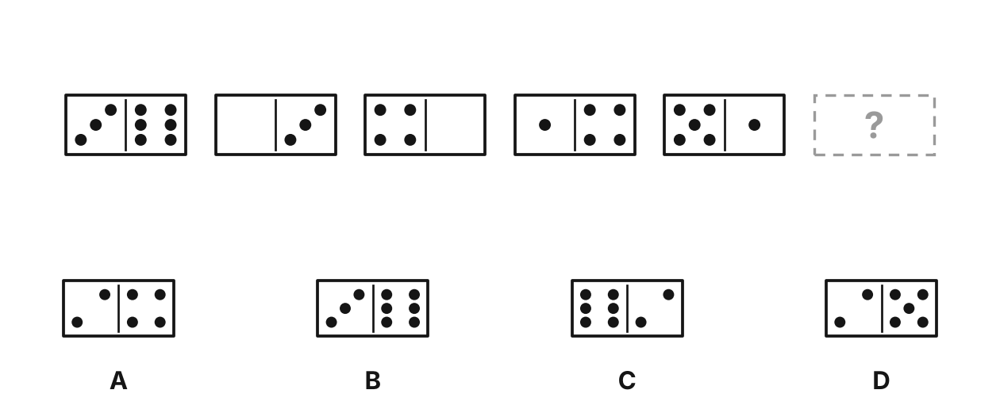
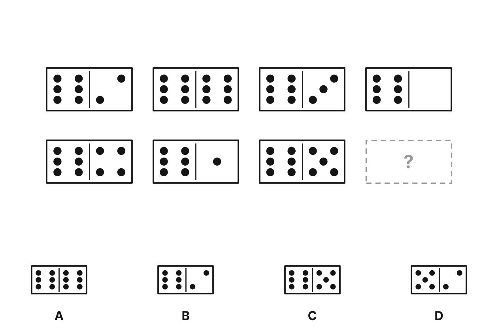
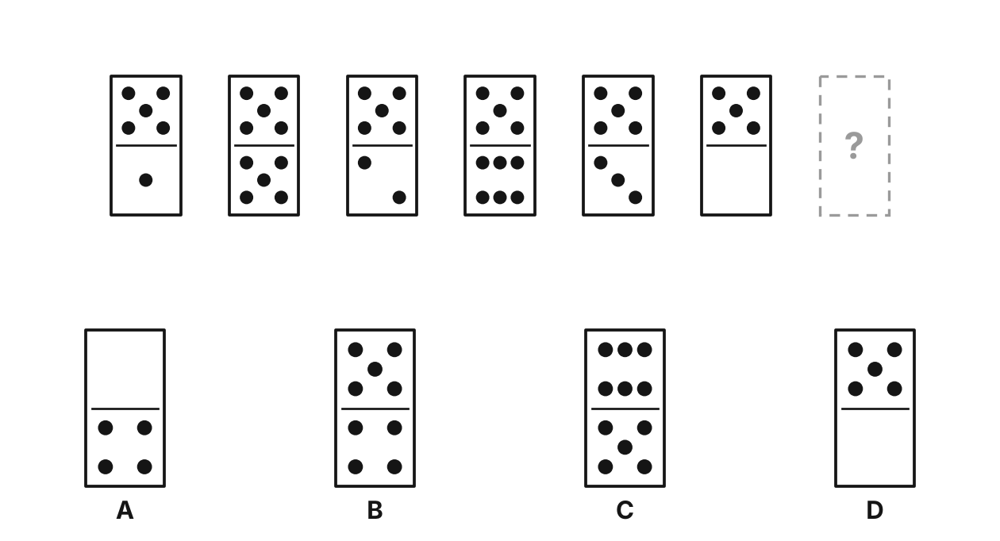

# Series de fichas

9 ejercicios · fácil: 4 · media: 3 · difícil: 2

## c8c6dc22f1 · fácil · domino_fila
*Test 010 (2026-11-06), ejercicio 33*

¿Qué ficha de dominó continúa la serie? (en fila)

**Respuesta: B.** Mira cada mitad por separado: las dos mitades suben 2 en cada paso (los puntos vuelven a 0 después del 6). La ficha que falta es 3–5.

## 5ec4e809ad · difícil · domino_espiral
*Test 010 (2026-11-06), ejercicio 34*

¿Qué ficha de dominó continúa la serie? (en espiral, desde la ficha de inicio hacia fuera)

**Respuesta: B.** Mira cada mitad por separado: la mitad izquierda sube 2 y la derecha sube 1 en cada paso (los puntos vuelven a 0 después del 6). La ficha que falta es 6–4.

## 5e5091d593 · fácil · domino_fila
*Test 010 (2026-11-06), ejercicio 35*

¿Qué ficha de dominó continúa la serie? (en fila)

**Respuesta: B.** Mira cada mitad por separado: la mitad izquierda sube 3 y la derecha se queda igual en cada paso (los puntos vuelven a 0 después del 6). La ficha que falta es 6–6.

## ed883bd1bf · media · domino_dos_filas
*Test 010 (2026-11-06), ejercicio 36*

¿Qué ficha de dominó continúa la serie? (en dos filas, de izquierda a derecha y de arriba abajo)

**Respuesta: A.** Mira cada mitad por separado: las dos mitades bajan 3 en cada paso (los puntos vuelven a 0 después del 6). La ficha que falta es 6–2.

## 1b65298bff · media · domino_dos_filas
*Test 012 (2026-11-08), ejercicio 31*

¿Qué ficha de dominó continúa la serie? (en dos filas, de izquierda a derecha y de arriba abajo)

**Respuesta: B.** Mira cada mitad por separado: las dos mitades bajan 1 en cada paso (los puntos vuelven a 0 después del 6). La ficha que falta es 4–0.

## 40981c5932 · difícil · domino_espiral
*Test 012 (2026-11-08), ejercicio 32*

¿Qué ficha de dominó continúa la serie? (en espiral, desde la ficha de inicio hacia fuera)

**Respuesta: B.** Mira cada mitad por separado: la mitad izquierda se queda igual y la derecha baja 1 en cada paso (los puntos vuelven a 0 después del 6). La ficha que falta es 0–6.

## dca75533bc · fácil · domino_fila
*Test 012 (2026-11-08), ejercicio 34*

¿Qué ficha de dominó continúa la serie? (en fila)

**Respuesta: D.** Mira cada mitad por separado: las dos mitades bajan 3 en cada paso (los puntos vuelven a 0 después del 6). La ficha que falta es 2–5.

## d477ffcfab · media · domino_dos_filas
*Test 012 (2026-11-08), ejercicio 35*

¿Qué ficha de dominó continúa la serie? (en dos filas, de izquierda a derecha y de arriba abajo)

**Respuesta: B.** Mira cada mitad por separado: la mitad izquierda se queda igual y la derecha baja 3 en cada paso (los puntos vuelven a 0 después del 6). La ficha que falta es 6–2.

## 3352482d8c · fácil · domino_fila_vertical
*Test 012 (2026-11-08), ejercicio 38*

¿Qué ficha de dominó continúa la serie? (en fila, con las fichas de pie, de izquierda a derecha)

**Respuesta: B.** Mira cada mitad por separado: la mitad superior se queda igual y la inferior baja 3 en cada paso (los puntos vuelven a 0 después del 6). La ficha que falta es 5–4.
