# Series de relojes

19 ejercicios · fácil: 2 · media: 13 · difícil: 4

## def99d1bcb · difícil · tarta
*Test 010 (2026-11-06), ejercicio 29*

¿Qué gráfico circular continúa la serie?

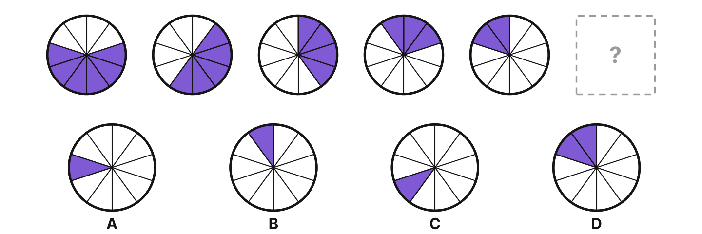

**Respuesta: A.** La tarta tiene 10 sectores. En cada paso el bloque relleno gira 1 sector a la izquierda y pierde 1 sector relleno.

## 6b4802d855 · media · puntos
*Test 010 (2026-11-06), ejercicio 30*

¿Qué círculo continúa la serie?

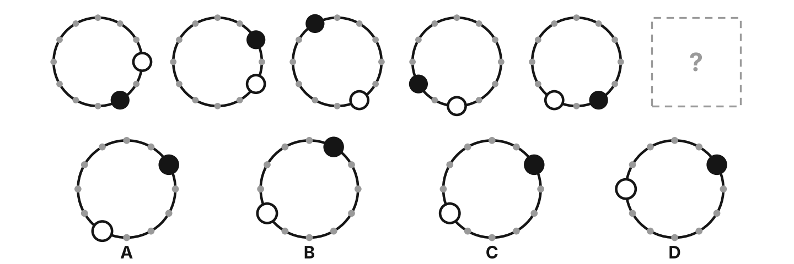

**Respuesta: C.** Hay 12 posiciones. El punto negro se mueve 3 posiciones en sentido antihorario y el punto blanco 1 posición en sentido horario en cada paso.

## 4ec3a4f9ed · media · puntos
*Test 010 (2026-11-06), ejercicio 31*

¿Qué círculo continúa la serie?

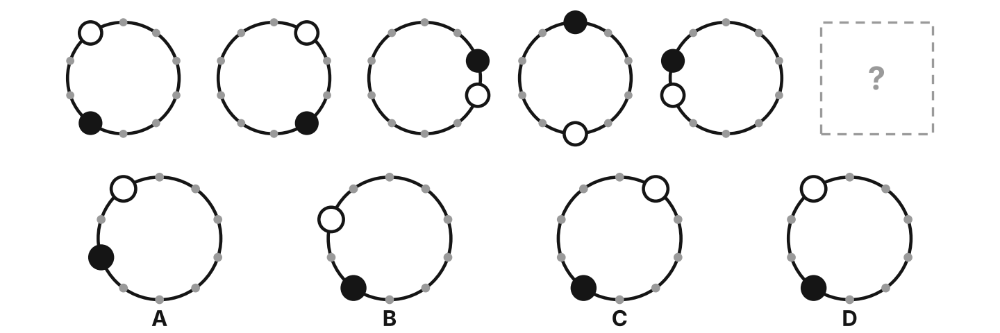

**Respuesta: D.** Hay 10 posiciones. El punto negro se mueve 2 posiciones en sentido antihorario y el punto blanco 2 posiciones en sentido horario en cada paso.

## b536fd62d0 · media · reloj
*Test 010 (2026-11-06), ejercicio 32*

¿Qué reloj continúa la serie?

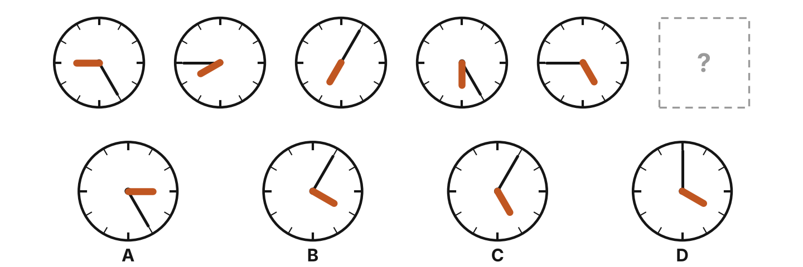

**Respuesta: B.** Sigue cada aguja por separado: la corta y gruesa retrocede 1 hora en cada reloj y la larga y fina avanza 4 horas (cada marca es una hora del reloj).

## 79ad4d91ad · media · puntos
*Test 013 (2026-11-09), ejercicio 26*

¿Qué círculo continúa la serie?

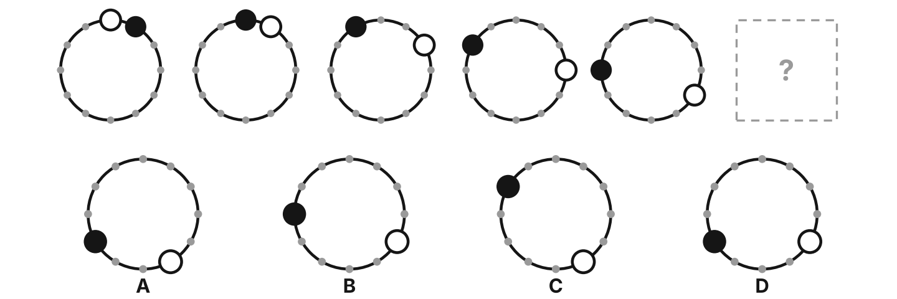

**Respuesta: A.** Hay 12 posiciones. El punto negro se mueve 1 posición en sentido antihorario y el punto blanco 1 posición en sentido horario en cada paso.

## fc29b43cc5 · difícil · tarta
*Test 013 (2026-11-09), ejercicio 29*

¿Qué gráfico circular continúa la serie?

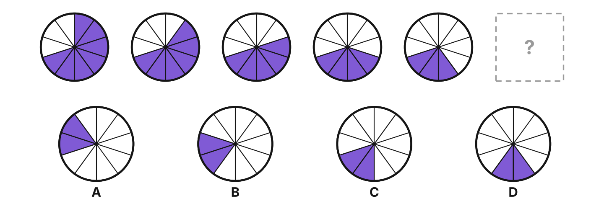

**Respuesta: C.** La tarta tiene 10 sectores. En cada paso el bloque relleno gira 1 sector a la derecha y pierde 1 sector relleno.

## 57d23dcaed · media · puntos
*Test 013 (2026-11-09), ejercicio 30*

¿Qué círculo continúa la serie?

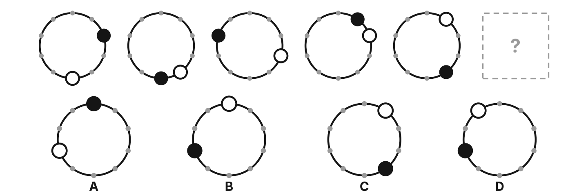

**Respuesta: B.** Hay 10 posiciones. El punto negro se mueve 3 posiciones en sentido horario y el punto blanco 1 posición en sentido antihorario en cada paso.

## 96ed1a8570 · fácil · tarta
*Test 014 (2026-11-10), ejercicio 26*

¿Qué gráfico circular continúa la serie?

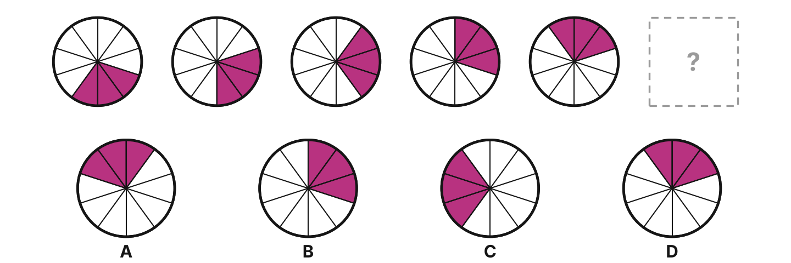

**Respuesta: A.** La tarta tiene 10 sectores. En cada paso el bloque relleno gira 1 sector a la izquierda.

## 2111135653 · media · puntos
*Test 014 (2026-11-10), ejercicio 28*

¿Qué círculo continúa la serie?

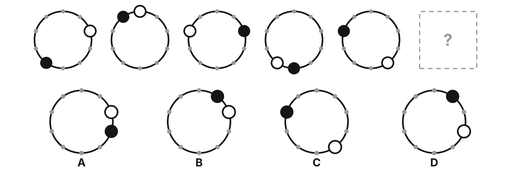

**Respuesta: B.** Hay 10 posiciones. El punto negro se mueve 3 posiciones en sentido horario y el punto blanco 2 posiciones en sentido antihorario en cada paso.

## 44a0c87a81 · media · reloj
*Test 014 (2026-11-10), ejercicio 30*

¿Qué reloj continúa la serie?

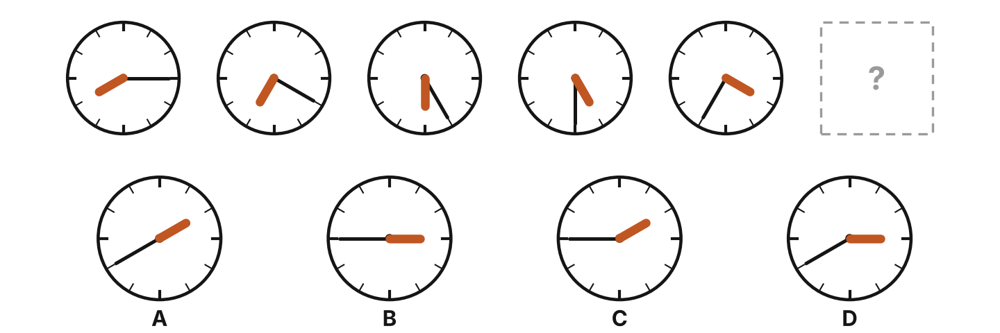

**Respuesta: D.** Sigue cada aguja por separado: la corta y gruesa retrocede 1 hora en cada reloj y la larga y fina avanza 1 hora (cada marca es una hora del reloj).

## 2504c61cc4 · media · reloj
*Test 014 (2026-11-10), ejercicio 32*

¿Qué reloj continúa la serie?

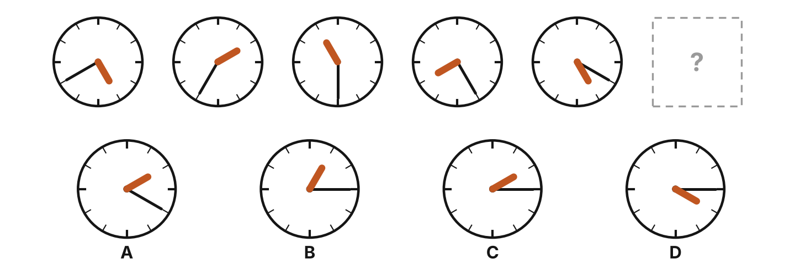

**Respuesta: C.** Sigue cada aguja por separado: la corta y gruesa retrocede 3 horas en cada reloj y la larga y fina retrocede 1 hora (cada marca es una hora del reloj).

## 33afb17eac · difícil · tarta
*Test 016 (2026-11-12), ejercicio 25*

¿Qué gráfico circular continúa la serie?

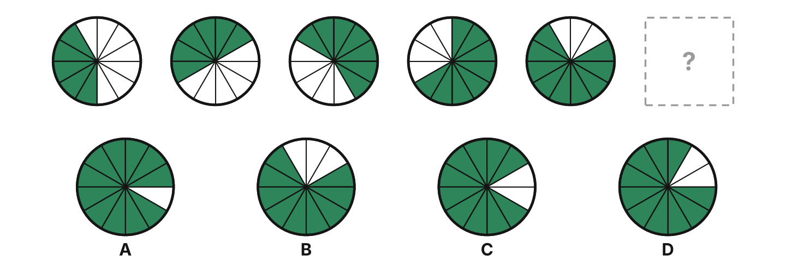

**Respuesta: C.** La tarta tiene 12 sectores. En cada paso el bloque relleno gira 2 sectores a la derecha y gana 1 sector relleno.

## bf428287cd · difícil · tarta
*Test 016 (2026-11-12), ejercicio 28*

¿Qué gráfico circular continúa la serie?

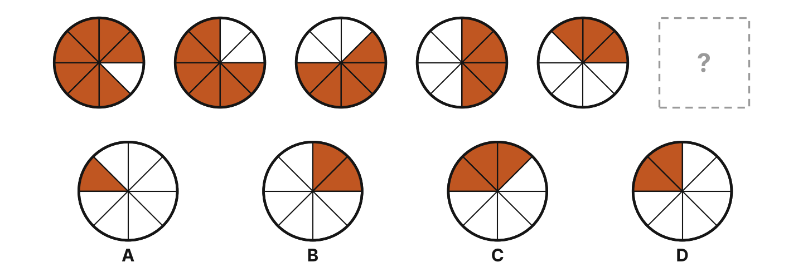

**Respuesta: D.** La tarta tiene 8 sectores. En cada paso el bloque relleno gira 1 sector a la izquierda y pierde 1 sector relleno.

## 73a6539f68 · media · reloj
*Test 016 (2026-11-12), ejercicio 29*

¿Qué reloj continúa la serie?

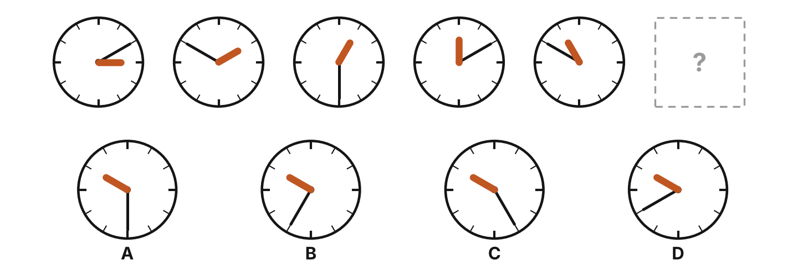

**Respuesta: A.** Sigue cada aguja por separado: la corta y gruesa retrocede 1 hora en cada reloj y la larga y fina retrocede 4 horas (cada marca es una hora del reloj).

## 566ef4e96c · media · reloj
*Test 016 (2026-11-12), ejercicio 32*

¿Qué reloj continúa la serie?

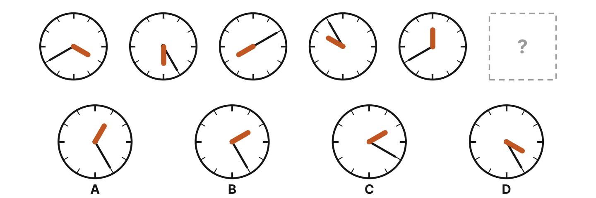

**Respuesta: B.** Sigue cada aguja por separado: la corta y gruesa avanza 2 horas en cada reloj y la larga y fina retrocede 3 horas (cada marca es una hora del reloj).

## 47948c51b4 · media · puntos
*Test 017 (2026-11-13), ejercicio 26*

¿Qué círculo continúa la serie?

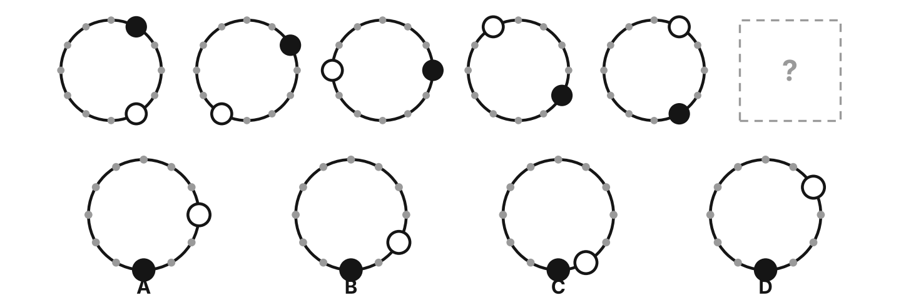

**Respuesta: A.** Hay 12 posiciones. El punto negro se mueve 1 posición en sentido horario y el punto blanco 2 posiciones en sentido horario en cada paso.

## 10cc68af59 · fácil · tarta
*Test 017 (2026-11-13), ejercicio 27*

¿Qué gráfico circular continúa la serie?

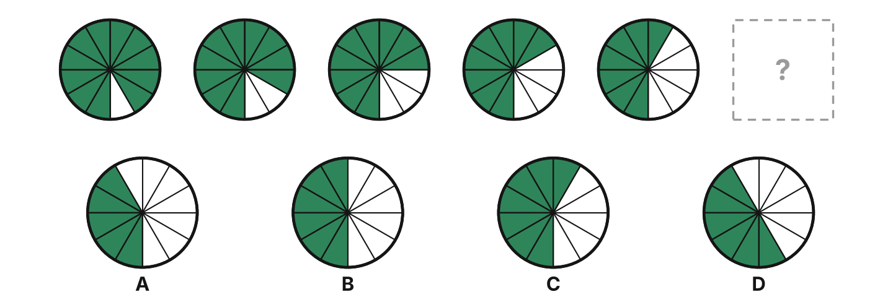

**Respuesta: B.** La tarta tiene 12 sectores. En cada paso pierde 1 sector relleno.

## f032bd5360 · media · puntos
*Test 017 (2026-11-13), ejercicio 29*

¿Qué círculo continúa la serie?

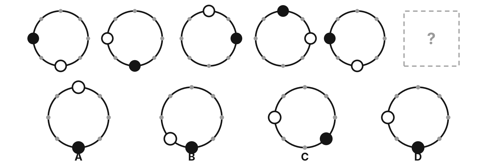

**Respuesta: D.** Hay 8 posiciones. El punto negro se mueve 2 posiciones en sentido antihorario y el punto blanco 2 posiciones en sentido horario en cada paso.

## 8368d2d13c · media · reloj
*Test 017 (2026-11-13), ejercicio 31*

¿Qué reloj continúa la serie?

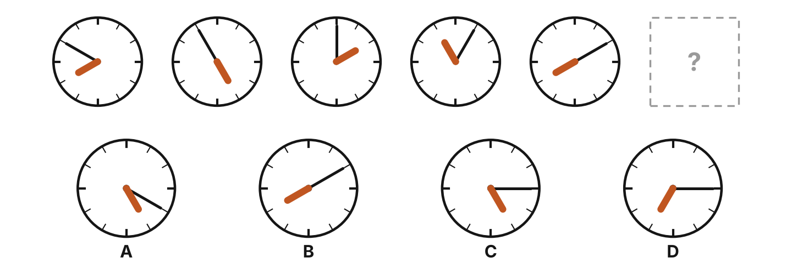

**Respuesta: C.** Sigue cada aguja por separado: la corta y gruesa retrocede 3 horas en cada reloj y la larga y fina avanza 1 hora (cada marca es una hora del reloj).
